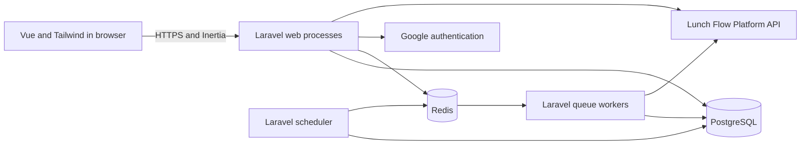
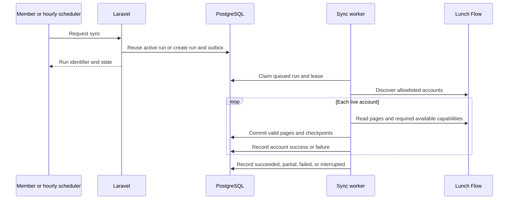

# Household finance app technical design

**Status:** Implementation reference; remaining product proposals and provider release gates are identified below. **Date:** October 3, 2026. **Scope:** application architecture, data model, financial calculations, workflows, UI contracts, integration, operations, testing, and delivery.

Build this application as a Laravel modular monolith with Inertia, Vue 3, TypeScript, Tailwind CSS, PostgreSQL, and Redis. PostgreSQL owns durable financial state and business invariants. Laravel owns authorization and calculations. Vue implements the existing component library and page designs. Redis supports queues, sessions, transient coordination, and disposable caches.

The stack and previously approved product rules are established requirements. The user subsequently authorized implementation of this design with Docker Compose. The repository now contains that implementation; see [Run instructions and release limitations](../README.md). Sections explicitly labeled **Business proposal** remain documented assumptions rather than previously approved product rules. Provider-dependent behavior remains conditional on contract and credential validation, and production operational targets require deployment verification.

### Reading guide

| Review area | Sections |
| --- | --- |
| Investigation and application shape | [Sources](#1-source-documents-and-investigation), [Architecture](#2-architecture), [Dependencies](#3-proposed-dependency-baseline), [Structure](#4-proposed-project-structure) |
| Persistence and isolation | [Schema](#5-storage-conventions-and-logical-schema), [Money and dates](#6-money-and-date-contracts), [Authentication and households](#7-authentication-and-household-isolation) |
| Financial behavior | [Recurrence](#8-recurrence-and-calendar), [Loans](#9-loans-and-balance-reconciliation), [Transactions](#10-transactions-and-attachments), [Accounts and cards](#11-accounts-card-bills-and-investments), [Budget](#12-categories-and-budget) |
| Background work | [Provider sync](#13-lunch-flow-integration-and-synchronization), [Reminders](#14-reminders-and-notifications), [Redis](#17-redis-queues-and-cache-policy) |
| User interface | [Frontend](#15-frontend-and-interaction-contracts), [Routes and DTOs](#16-routes-and-response-contracts) |
| Production readiness | [Security and retention](#18-security-history-and-retention), [Operations](#19-hosting-deployment-and-recovery), [Verification](#20-verification-plan), [Delivery](#21-proposed-implementation-phases-and-release-gates) |
| Decisions needing review | [Review register](#22-review-register) |

## 1 Source documents and investigation

Read this design alongside [Product requirements](product-requirements.md), [Households and permissions](households-and-permissions.md), [Schedules and calendar](schedules-and-calendar.md), [Accounts and transactions](accounts-and-transactions.md), [UI design](ui-design.md), [Component library](component-library.md), [Technical planning](technical-planning.md), [Decision history](decision-history.md), and [Open decisions](open-decisions.md). Approved requirements take precedence over this draft and illustrative design values.

The repository currently contains documentation and 81 PNG design exports. There is no application, dependency manifest, database, automated test suite, or deployment configuration. It is also not currently a Git checkout. No application behavior has therefore been verified by running it.

The review used the written screen inventory for every section and visually inspected representative exports for Home, Manage bill payment, Budget, Accounts, Edit loan, Connection details, and Delete category. Static exports establish layout intent, not working interactions, accessibility, bank coverage, or calculation correctness. Phone designs were deferred; the product still needs a usable phone experience before release.

### 1.1 Findings that shape the architecture

| Finding | Design consequence |
| --- | --- |
| A user has at most one current household; household records never migrate with them | Explicit current-membership lookup, household-scoped queries, retained member identities, and database uniqueness |
| Ordinary members can edit all financial records; administrative actions are owner-only | Membership policies rather than private-record or account-owner policies |
| Source fields on imported transactions are immutable to members | Separate provider fields, household annotations, and classification provenance |
| Calendar totals use schedules; Budget uses actual transactions | Separate query services and contracts; attachments never join into spending aggregates |
| Paid and received history survives future series edits | Stable occurrence identities, effective series revisions, field-level overrides, and completed snapshots |
| Loan payments change loan balances, but manual transaction edits/deletions do not reverse balances | Distinct payment records and balance events; explicit reconciliation boundaries |
| A transaction can have retained historical attachments and one current attachment | Database uniqueness on active attachment claims, separate from retained links |
| Hourly sync allows partial success without automatic failure retries | Durable sync runs, per-account results, incremental commits, explicit retry policy |
| Reminder settings can intentionally generate a second notification | Versioned reminder plans and durable delivery uniqueness rather than one lifetime reminder per occurrence |
| Category deletion changes historical spending but preserves locked historical targets | Mutable current category assignments and separate effective target history |
| Investments, unknown card statement amounts, and historical chart coverage are incomplete | Capability flags and explicit unknown values; no invented financial data |

### 1.2 Scope boundaries

Cover the approved Home calendar; Bills and Income; Subscriptions; Accounts; Loans; Investments where provider data permits; Budget; Transactions; Household; Categories; Notifications; Profile; Google sign-in; and required household setup.

Do not add payment execution, order placement, financial advice, expense splitting, chat, multi-currency conversion, email/SMS/push reminders, a native app, a paid app subscription, or file-import workarounds. The public landing page and several visual behaviors remain proposals in section 22.

## 2 Architecture

### 2.1 Runtime topology



Deploy one codebase as independently scalable web, worker, and scheduler processes. Use a private PostgreSQL primary and private Redis services. Google and Lunch Flow are external boundaries. Serve fingerprinted frontend assets from the web host initially, with a CDN optional later. No financial record file-upload workflow is approved, so an application object store is not required; backups use private storage supplied by the hosting environment.

Start with conventional PHP-FPM behind an HTTPS reverse proxy. Do not require Octane, Kubernetes, microservices, WebSockets, or frontend SSR. Authenticated pages gain little from SSR; if the public website is approved, a Blade landing page can provide crawlable content without introducing a separate SSR runtime.

### 2.2 Domain boundaries

| Domain | Owns | Main application actions and read services |
| --- | --- | --- |
| Identity | Google identity, profile, sessions | SignInWithGoogle, UpdateProfile |
| Households | Membership, invitations, ownership, access | CreateHousehold, AcceptInvitation, LeaveHousehold, TransferOwnership, DeleteHousehold |
| Categories | Default seeding, hierarchy, replacement | CreateCategory, MoveCategory, DeleteCategory |
| Scheduling | Series, revisions, occurrences, account selections | CreateSeries, EditOccurrence, EditFutureSeries, MaterializeOccurrences, CalendarQuery |
| Loans | Loan configuration, payments, repayment projection | RecordInstallmentPayment, ReverseInstallmentPayment, RecordExtraPayment, RebuildUnpaidInstallments |
| Accounts | Account metadata, balances, card limits and terms | CreateManualAccount, RecordBalance, RecordCreditLimit, AccountHistoryQuery |
| Transactions | Imported identity, annotations, hiding, attachments | CreateManualTransaction, UpdateAnnotation, DeleteTransaction, AttachTransaction, SuggestMatches |
| Connections | Authorization contexts, discovery, sync | StartProviderAuthorization, RequestConnectionSync, SyncConnection, DisconnectConnection |
| Budget | Spending query, effective targets, monthly alerts | BudgetQuery, ChangeTarget, EvaluateBudgetAlert |
| Investments | Holdings and trading read models | InvestmentQuery, ApplyHoldingsSnapshot |
| Notifications | Reminder plans, deliveries, read/dismiss state | PlanReminder, DeliverReminder, OpenNotification |
| History | Durable actor and field changes | AppendAuditEvent, HistoryQuery |

Keep controllers thin: validate a request, resolve current access, call an action or query, and produce an Inertia page, redirect, or JSON DTO. Application actions own transactions and domain validation. Eloquent models provide persistence and relationships, not all-purpose business services. Value objects handle money, dates, recurrence rules, and normalized provider data.

A module may call another module's application action within the same transaction. Avoid generic repository wrappers around Eloquent and a separate service for every model. Use provider interfaces at actual external boundaries.

### 2.3 Transaction and event model

For a mutation, the durable transaction includes business rows, version increments, field-level audit events, and any outbox message needed for asynchronous work. Commit before dispatching jobs. An outbox dispatcher publishes committed messages to Redis. If publishing is duplicated, consumers deduplicate by message ID and domain uniqueness.

Use actions and query services rather than full event sourcing. Audit history explains changes, while current tables remain the normal source of truth. Explicit balance/payment events provide the additional financial history that those domains need.

Materialization and notifications use at-least-once processing with database-enforced idempotency. No claim of exactly-once execution across PostgreSQL, Redis, and a provider is made.

## 3 Proposed dependency baseline

Freeze exact patch versions and dependency locks when implementation is approved. The following is a compatibility baseline, not a claim that every listed component was installed or tested together.

| Component | Proposed baseline | Reason and validation |
| --- | --- | --- |
| PHP | 8.4, latest maintained patch | Supported by Laravel 13; enable PostgreSQL, Redis, BCMath, Intl, and normal Laravel extensions |
| Laravel | 13.x | Current framework generation; use supported patch releases |
| Inertia | 3.x Laravel and Vue adapters | Keep adapters on compatible releases; validate middleware, history, polling, and forms together |
| Vue | 3.x with Composition API | Existing approved component direction; pin a compatible maintained minor |
| TypeScript | Compatible maintained release | Strict mode and Vue type checking |
| Tailwind | 4.x | CSS theme tokens; confirm browser coverage before locking |
| PostgreSQL | 17.x latest patch | Supported production baseline; managed PostgreSQL 18 is an alternative requiring the same CI verification |
| Redis | Maintained 8.x release available from selected host | Verify PHP client and Horizon compatibility; deployment/vendor terms remain to select |
| Assets | Vite, Laravel Vite plugin, Vue plugin, supported Node LTS | Build in CI; exact versions selected as one tested toolchain |
| Google login | Laravel Socialite | First-party Google OAuth integration; no password-login scaffolding |
| Charts | Chart.js and vue-chartjs | Already approved; pin compatible releases |
| PHP quality | PHPUnit, Laravel Pint, PHPStan with Larastan | Proposed automated correctness and type checks |
| UI quality | Vitest, Vue Test Utils, Playwright, axe-core | Proposed component and browser verification |
| Worker monitoring | Laravel Horizon | Proposed Redis queue supervision; private authenticated operational access |

Laravel 13 requires PHP 8.3 or later and its support table includes PHP 8.4. The Inertia 3 Laravel adapter declares Laravel 13 support. These narrow compatibility facts were checked in the [Laravel release notes](https://laravel.com/framework/docs/13.x/releases) and the [official adapter manifest](https://raw.githubusercontent.com/inertiajs/inertia-laravel/3.x/composer.json); dependency resolution and integration tests still remain.

Tailwind 4 depends on modern browser features; its documented minimums include Chrome 111, Safari 16.4, and Firefox 128. The proposed release support policy is current and previous stable Chrome, Edge, Firefox, and Safari, plus current iOS Safari and Android Chrome for basic phone usability. Confirm this policy before implementation. See [Tailwind compatibility](https://tailwindcss.com/docs/compatibility). PostgreSQL 17 remains supported according to its [version policy](https://www.postgresql.org/support/versioning/).

Do not install a headless component library, Storybook, a calendar framework, Vue Router, an app billing package, or token authentication for the first-party browser. They are either contrary to existing choices or unnecessary for the selected architecture. Additional packages need an identified purpose and a compatibility/security review.

## 4 Proposed project structure

```text
app/
  Domain/
    Identity/ Households/ Categories/ Scheduling/ Loans/
    Accounts/ Transactions/ Connections/ Budget/ Investments/
    Notifications/ History/
      Actions/ Queries/ Data/ Rules/ ValueObjects/
  Models/
  Policies/
  Http/Controllers/ Requests/ Middleware/
  Integrations/LunchFlow/ Contracts/ Data/ Normalizers/
  Jobs/
  Console/Commands/
resources/
  css/app.css
  js/
    app.ts
    pages/Auth/ Setup/ Home/ BillsIncome/ Subscriptions/
          Accounts/ Loans/ Investments/ Budget/ Transactions/
          Household/ Categories/ Notifications/ Profile/
    layouts/
    components/primitives/ patterns/ finance/
    composables/
    types/
    lib/money.ts dateOnly.ts chartTheme.ts
routes/web.php
database/migrations/ factories/ seeders/
tests/Unit/ Feature/ Integration/
tests/frontend/ e2e/
docs/
```

Keep domain folders small until complexity warrants subfolders. Shared component props and emitted events are documented in source and component tests. The existing component-library document is the inventory; there is no separately hosted component catalog. Route names and DTO types are exported by a small build-time generation command, or maintained explicitly until generation is justified. Do not introduce a route/type package implicitly.

## 5 Storage conventions and logical schema

### 5.1 Common conventions

- Use PostgreSQL UUID primary keys, generated by the application. Send IDs as strings.
- All household-owned tables carry `household_id`, including relation tables, audit events, sync runs, and projections. User-level tables such as users and sessions do not.
- Use `timestamptz` for instants; database connection timezone and Laravel application timezone are UTC. Use `date` for financial and schedule calendar dates, and `time without time zone` for personal reminder time paired with an IANA timezone.
- Mutable records have `lock_version bigint NOT NULL DEFAULT 1`. Updates use compare-and-swap or row locks. Retained deletable domain rows have `deleted_at`, `deleted_by_user_id`, and a deletion reason where relevant.
- Money is signed `bigint` cents or nonnegative cents according to the field. Monetary aggregates use PostgreSQL numeric sums and are range-checked before entering application value objects. API money values are decimal strings of minor units, not floating point numbers.
- Use text plus check constraints for finite state/kind values. JSONB is for bounded snapshots, field overrides, provider metadata, and audit deltas; searchable relationships and financial amounts remain typed columns.
- No cascade hard deletion of household financial records. Foreign keys normally restrict deletion. Soft deletion is an explicit domain operation with history.
- Create `(household_id, id)` unique keys on referenced household tables. Household-local foreign keys include both columns, preventing a relationship to a different household even if a controller makes a mistake.

The following is the logical migration specification. Columns described as references use foreign keys; normal timestamps and common version/deletion columns are omitted from repeated table cells. Proposed conditional fields are not approval of the corresponding business policy.

### 5.2 Identity and household tables

| Table | Important columns | Constraints and lifecycle |
| --- | --- | --- |
| `users` | id, google_subject, google_email, email_normalized, email_verified_at, display_name, timezone, reminder_local_time, reminder_settings_version | Unique google_subject; timezone validated against IANA; reminder default 09:00; Google subject is identity, email is invitation routing |
| `households` | id, name, owner_member_id, access_version, data_version, category_version | Owner points to a member of the same household; soft deletion immediately disables access and sync |
| `household_members` | id, household_id, user_id nullable, nickname, joined_at, left_at, deleted_at | Partial unique user_id where linked and active; partial unique household_id/user_id for active linked membership; retain nickname and user link after departure |
| `invitations` | id, household_id, target_email_normalized, target_member_id nullable, invited_by_member_id, status, accepted_by_user_id, accepted_at, canceled_at, declined_at | Pending/accepted/declined/canceled; multiple pending for the same email allowed; no expiry; accepting requires verified current email and an available target member |
| `oauth_authorization_requests` | id, user_id, household_id nullable, purpose, state_hash, initiating_access_version, provider_authorization_id nullable, return_path, expires_at, consumed_at | Single-use state; expiration of a callback request does not expire a household invitation |
| `sessions` | Driver-managed opaque session ID and payload in Redis | User identity only; never treat cached household role as authority |

Creating a household inserts its owner member and category seeds in one transaction. A deferred constraint trigger validates that each non-deleted household has an active, linked owner; it allows the household/member creation cycle to complete before checking. Transfer and deletion use the same transaction discipline. A pointer to an inactive or unlinked owner is invalid.

### 5.3 Categories and effective targets

| Table | Important columns | Constraints and lifecycle |
| --- | --- | --- |
| `categories` | id, household_id, parent_id nullable, kind, name, name_normalized, system_key nullable | kind expense/income/transfer; same-household parent; sibling names unique among active rows, including roots via separate partial indexes; max depth one; immutable kind |
| `category_seed_mappings` | household_id, seed_key, category_id nullable, replacement_category_id nullable, retired_at | Stable default semantic keys survive rename; a deleted mapping cannot recreate a category |
| `budget_target_periods` | id, household_id, category_id, valid_from_month, valid_to_month nullable, target_cents nullable | First-of-month dates; non-overlapping half-open intervals per category; null target is explicit no-target period; only top-level expense categories |
| `budget_target_overrides` | id, household_id, category_id, month, target_cents nullable | Unique category/month; a null amount deliberately suppresses a recurring target for that month |
| `budget_alerts` | id, household_id, category_id, month, target_cents_at_alert, spent_cents_at_alert, triggered_at | Unique category/month, retained through target edits/removal and spending recrossings |

Implement depth, same-type parent, and built-in protection with domain validation and database triggers for cross-row constraints. Transfers Between Accounts cannot be renamed, moved, deleted, or receive children. Loan Payments remains an expense root, cannot be renamed/deleted/moved, and may have children and targets.

Use a PostgreSQL exclusion constraint on effective target ranges, with `btree_gist` if supported by the selected hosting service; if unavailable, lock the category and enforce ranges in a constraint trigger. Do not rely solely on two racing application checks.

### 5.4 Accounts and transaction tables

| Table | Important columns | Constraints and lifecycle |
| --- | --- | --- |
| `accounts` | id, household_id, connection_id nullable, provider_authorization_id nullable, provider_account_key nullable, source, type, name, institution_name, member_id nullable, notes, balance_cents nullable, balance_observed_at nullable, balance_effective_date nullable, import_start_date nullable, discovery_date nullable, last_success_at, latest_error_code | source manual/provider; type cash/checking/savings/credit_card/loan/investment; manual investment creation not enabled; provider identity unique including deleted rows |
| `account_balance_events` | id, household_id, account_id, kind, balance_cents, delta_cents nullable, effective_date, observed_at, recorded_at, transaction_id nullable, loan_payment_id nullable, idempotency_key | Append-only financial observations/effects; zero is distinct from unknown; unique idempotency key within account; transaction balance effects use their own balance effective date |
| `credit_card_terms` | household_id, account_id, apr_decimal nullable, fee_cents nullable, fee_cadence nullable, statement_day nullable, due_day nullable, usual_paying_account_id nullable, next_fee_date nullable, payment_bill_enabled, fee_bill_enabled | One row per card; days 1–31; APR/reference fees never change balances automatically |
| `credit_limit_entries` | id, household_id, account_id, effective_date, limit_cents, note, recorded_by_member_id | Nonnegative; one active entry per card/effective date; corrections audited; current limit is latest effective entry not in the future |
| `transactions` | id, household_id, account_id, source, amount_cents, transaction_date, payee, status, category_id nullable, category_origin, notes, hidden_at nullable, provider_classification nullable, manual_classification nullable, provider_updated_at nullable | source manual/provider; status pending/posted; member APIs cannot write provider amount/date/payee; positive inflow, negative outflow |
| `provider_transaction_identities` | id, household_id, provider_authorization_id, provider_account_key, external_transaction_key, transaction_id, identity_kind | Unique external key within authorization/account, including identities of soft-deleted transactions; multiple identities may point to one canonical app transaction |
| `provider_identity_conflicts` | id, household_id, account_id, sync_run_id, redacted_evidence, state | Quarantine ambiguous identities or unsupported payloads; do not guess a duplicate merge |
| `occurrence_transaction_links` | id, household_id, occurrence_id, transaction_id, linked_by_member_id, linked_at, detached_at nullable, active_claim | Retain historical links; unique transaction_id where active_claim and not detached; claim is released when occurrence is deleted |

Account source and type are stable after creation; unsupported provider classifications are quarantined rather than silently converted. The connection/auth identity survives local soft deletion, preventing rediscovery from recreating deleted accounts. Account-deletion treatment of unattached transactions is a business proposal in section 11.

The attachment partial unique index is global on canonical transaction_id, which is already household-scoped by composite foreign keys. A database trigger prevents active claims for deleted occurrences and releases claims when an occurrence is deleted. Normal detach sets detached_at and active_claim=false. History still records the former relation. This directly enforces the approved distinction between one live attachment and many historical attachments.

### 5.5 Scheduling and loan tables

| Table | Important columns | Constraints and lifecycle |
| --- | --- | --- |
| `scheduled_series` | id, household_id, kind, name, current_revision_id, subscription_cancel_date nullable, generated_by_account_id nullable, generated_purpose nullable, generated_link_active, generation_coverage, generation_version | kind bill/income/subscription/loan_installment; unique active generated link per account/purpose; retained old lineages; cancellation date write-once; coverage records built intervals and revision |
| `series_revisions` | id, household_id, series_id, revision_number, effective_from_slot, changed_fields, recurrence_rule, name, amount_cents nullable, category_id nullable, member_id nullable, inclusive_end_date nullable | Immutable revisions; fields are explicit; nullable amount only for proposed statement-amount workflow |
| `series_revision_accounts` | household_id, revision_id, account_id | Unique revision/account; same household; no account type restriction |
| `series_revision_recipients` | household_id, revision_id, member_id | Income cannot have reminder recipients; no-login member cannot receive delivery |
| `occurrences` | id, household_id, series_id nullable, generation_key, slot_order, nominal_date, due_date, kind, name, amount_cents nullable, amount_state, category_id nullable, member_id nullable, status, completed_date nullable, resolved_revision_id, field_overrides, completed_snapshot nullable, reminder_version | Unique series/generation_key including deleted rows; unpaid/paid or not_received/received by kind; completion date only for completed items; amount_state known/awaiting_statement is conditional on B07 |
| `occurrence_accounts` | household_id, occurrence_id, account_id | Current effective selection; audit preserves removed relations |
| `occurrence_recipients` | household_id, occurrence_id, member_id, reminder_version | Current effective selection; member association independent of assignee |
| `series_suppression_ranges` | id, household_id, series_id, first_slot, last_slot nullable, reason, recorded_at | Stops unmaterialized slots after scoped deletion; prevents lazy generation from recreating removed occurrences |
| `loans` | id, household_id, account_id, schedule_series_id nullable, tracking_mode, repayment_total_cents nullable, installment_cents nullable, reconciliation_version | One per Loan account; total/history versus opening-balance mode; balance-only mode lacks percentage |
| `loan_payments` | id, household_id, loan_id, occurrence_id nullable, kind, amount_cents, payment_date, reversed_at nullable, deleted_at nullable | kind installment/extra/past_payment; positive amount; unique active installment payment per occurrence; extra has no unpaid state |
| `loan_balance_checkpoints` | id, household_id, loan_id, balance_cents, effective_date, observed_at, included_payment_set, reconciliation_state | Conditional reconciliation proposal; identifies exactly which payment effects a direct/provider observation already includes |
| `loan_payment_accounts` | household_id, loan_payment_id, account_id | Paying-account context for extra/past payments; never automatically debits these accounts |

Occurrences are the stable target for calendar actions, completion, audit, reminders, and attachments. A loan installment and an ordinary bill do not have parallel independent payment-status systems. Marking a loan occurrence paid writes its loan payment and occurrence state in one transaction.

`field_overrides` is a validated field-name-to-value map, not an arbitrary patch. Account/recipient sets have explicit override flags so an empty selection is distinct from inherited selection. Completed snapshots freeze the resolved fields through ordinary future edits. Category rename/deletion remains a deliberate global exception affecting labels and assignments, including completed records.

### 5.6 Provider, investments, notifications, and infrastructure tables

| Table | Important columns | Constraints and lifecycle |
| --- | --- | --- |
| `provider_authorizations` | id, household_id, provider_user_key, authorizing_member_id, encrypted_access_token, encrypted_refresh_token, token_expires_at, credential_version, state | A provider user/token context may contain several bank connections; never model tokens as automatically unique per bank connection |
| `provider_resource_bindings` | id, provider_namespace, provider_user_key, resource_kind, external_resource_key, household_id, connection_id nullable, account_id nullable, bound_at | Global unique upstream-scoped resource identity including deleted bindings; restricted discovery lookup returns ownership verdict only; assignment cannot migrate between households |
| `connections` | id, household_id, provider_authorization_id, external_connection_key, institution_name, member_id nullable, state, last_full_success_at, latest_error_code, latest_error_at, lifecycle_version | Unique authorization/external key including deleted rows; active/requires_reauthorization/disconnecting/disconnected |
| `sync_runs` | id, household_id, connection_id, trigger, hourly_bucket nullable, requested_by_member_id nullable, state, started_at, finished_at, lease_token, lease_expires_at, latest_error_code | One queued/running run per connection via partial unique index; unique scheduled connection/hour bucket |
| `sync_account_runs` | id, household_id, sync_run_id, account_id, state, import_start_date_snapshot, cursor_before, cursor_after, page_count, imported_count, corrected_count, removed_count, error_code | Unique run/account; required capabilities recorded so unsupported holdings are not a false failure |
| `account_sync_checkpoints` | household_id, account_id, stream, cursor nullable, covered_from_date nullable, covered_to_date nullable, backfill_from_date nullable | Unique account/stream; cursors advance only after corresponding pages commit |
| `holdings_snapshots` | id, household_id, account_id, sync_run_id, observed_at, provider_as_of nullable, complete, cash_cents nullable | Replace current holdings only from an explicitly complete account snapshot |
| `holding_positions` | id, household_id, snapshot_id, security_key, symbol nullable, description, quantity_decimal, unit_price_decimal nullable, market_value_cents nullable, cost_basis_cents nullable | Decimal quantity/price; USD only; missing cost does not become zero |
| `investment_activity` | id, household_id, account_id, external_key, activity_date, kind, quantity_decimal nullable, amount_cents nullable, transaction_id nullable | Provider-confirmed identity; optional link to one canonical cash transaction; no separate Budget inclusion |
| `reminder_plans` | id, household_id, occurrence_id, recipient_member_id, recipient_user_id, plan_version, scheduled_at, state, catch_up_allowed, settings_fingerprint | Unique occurrence/recipient/version; scheduled/skipped/sent/canceled; durable version changes distinguish intentional new reminders |
| `reminder_deliveries` | id, household_id, plan_id, notification_id, delivered_at | Unique plan_id; delivery and notification inserted atomically |
| `notifications` | id, recipient_user_id, household_id nullable, membership_id nullable, kind, occurrence_id nullable, invitation_id nullable, budget_alert_id nullable, event_snapshot, read_at nullable, dismissed_at nullable | User-owned history retained indefinitely; details serialized only under current access; fanout keys unique per originating event/recipient |
| `audit_events` | id, household_id nullable, subject_type, subject_id, actor_kind, actor_user_id nullable, actor_member_id nullable, actor_nickname_snapshot, action, field_changes, recorded_at, command_id, related_subjects | Append-only; actor member snapshot preserves meaning after departure; provider/system actors distinguished |
| `outbox_messages` | id, household_id nullable, event_type, payload, created_at, published_at nullable | Durable dispatch bridge; allowlisted IDs and small data, no credentials |
| `processed_messages` | consumer, message_id, processed_at | Unique consumer/message; durable consumer idempotency |
| `command_receipts` | id, user_id nullable, household_id nullable, command_key, payload_hash, response_reference, committed_at, expires_at | Unique actor/scope/key; identical retry returns previous result, different payload conflicts; always reauthorize receipt access |

There is no approved holding-trade execution or market-price feed. Investment tables describe ingestion/read capability only. Include optional provider currency in staging validation, but only accepted USD data becomes a financial record.

### 5.7 Indexes and query boundaries

Create indexes based on these access patterns, then verify real query plans:

- Active occurrences: `(household_id, due_date, id)`; series/slot lookups; status where useful for unpaid-only views.
- Transactions: `(household_id, transaction_date DESC, id DESC)` and `(household_id, account_id, transaction_date DESC, id DESC)` for live rows. Budget uses household/date and category joins; matching uses account, exact amount, and a bounded date range.
- Audit: `(household_id, subject_type, subject_id, recorded_at DESC, id DESC)`.
- Notifications: recipient/read/dismissed state plus timestamp/id; pending invitation lookup on normalized email/status.
- Sync: active connection state, run lease expiry, per-account status; provider identity keys include retained deleted rows.
- Reminder plans: scheduled_at where state=scheduled, plus occurrence/recipient/version uniqueness.

Start payee search with bounded, parameterized `ILIKE` and pagination. Add a `pg_trgm` index only if measured household transaction volumes warrant it. Never return a household's entire transaction or audit history as shared Inertia props.

## 6 Money and date contracts

### 6.1 Money

Use a `UsdMoney` value object backed by integer cents. Parse decimal input as a string; reject more than two fractional digits, malformed separators, overflow, and disallowed signs. Do not round member-entered fractions silently. Provider precision beyond cents follows an explicitly verified mapping; quarantine unexplained precision instead of guessing.

Transaction amounts use a cash-flow sign: positive means money in; negative means money out, regardless of account type. Account balances use asset/debt semantics: positive cash/investment is an asset; positive card/loan is owed. A negative card balance can represent a credit only under the business proposal in section 11.

This sign mapping is internal architecture. The proposed Money in/Money out toggle in the UI still needs approval. Once approved, its positive magnitude is normalized to signed cents at the request boundary.

For a manual balance-changing transaction on an asset account, `new_balance = old_balance + transaction_amount`. On a liability account, `new_owed = old_owed - transaction_amount`. Thus a $25 outflow increases credit-card debt by $25. Creating a transaction may append one balance event; editing/deleting it does not rewrite or reverse that event.

Reject application monetary fields outside a proposed USD range of absolute $999,999,999.99 per value. Reassess the cap before implementation; it is validation, not a database bigint limit. Send money as `{currency: "USD", minor: "11800"}`. JavaScript uses string/BigInt helpers for calculations and only converts bounded display values to chart numbers. Percentages are presentation values calculated from exact server amounts, not reused as money.

### 6.2 Calendar dates and instants

| Value | Representation | Interpretation |
| --- | --- | --- |
| Due/scheduled date | YYYY-MM-DD and SQL date | Same date for every member; never parse through `new Date(dateString)` for display |
| Transaction date | YYYY-MM-DD and SQL date | Proposed provider financial date preserved verbatim; no viewer-timezone shift |
| Actual payment/received date | YYYY-MM-DD and SQL date | Default today in acting user's profile timezone; editable |
| Budget month | YYYY-MM and first-of-month date | UTC month boundary for default view, locks, and alerts |
| Creation/audit/sync/reminder instant | ISO 8601 UTC with Z and timestamptz | Display in viewer's profile timezone |
| Personal reminder time | HH:mm plus IANA timezone | Convert occurrence date and local time to a UTC delivery instant |

**Business proposal:** use the provider's supplied financial date for Budget and matching, including pending-to-posted date corrections. If only a timestamp is supplied, derive a date using a documented provider/account timezone; do not fall back silently to the viewing member's timezone. This resolves the transaction-date question only after provider validation and product approval.

**Business proposal:** use the viewer's profile date for Home's today marker, overdue labels, subscription cancellation state, and actual-payment defaults. The same occurrence date remains fixed; members near midnight may see different overdue/today labels. Budget remains explicitly UTC. These date-boundary choices need approval because the requirement specifies date-only schedules without selecting every operational notion of today.

Use a deterministic recurrence/date service in PHP. Vue preview calls the same service via an authenticated endpoint. Browser timezone detection is an onboarding suggestion, not a trusted instruction about household dates.

## 7 Authentication and household isolation

### 7.1 Google sign-in

Propose Laravel Socialite's stateful Google flow. [Socialite supports Google](https://laravel.com/framework/docs/13.x/socialite); identity and invitation verification still require the application's explicit rules.

1. Start a same-origin authorization request with random, single-use state tied to the browser session. Allow only an internal return path.
2. On callback, validate state and provider response, retrieve verified Google identity, and identify the user by stable Google subject. Require verified email for invitation acceptance. Do not auto-link two different Google subjects by matching email.
3. Store current name/email and minimal identity metadata. Do not retain Google access/refresh tokens after login unless a later approved feature needs them. Google login does not authorize bank access.
4. Regenerate the Laravel session ID after login. Use secure, HttpOnly, SameSite=Lax cookies on HTTPS, normal CSRF middleware, and server-side Redis sessions. Proposed idle lifetime is two hours with no persistent remember-me cookie.
5. Resolve current household from PostgreSQL. Go to Home if active, otherwise setup. Normal Profile and notification pages remain inaccessible until setup; invitation acceptance/decline and sign-out are allowed in setup.

**Business proposal:** normalize invitation emails by trimming and case folding, without stripping Gmail dots or plus suffixes. Match to the currently verified Google email. A changed email does not claim invitations for the old email; the owner sends a new invitation if necessary. A pre-existing notification does not bypass acceptance checks.

### 7.2 Authorization layers

Apply `auth`, `RequireActiveHousehold`, scoped route binding, and action policies. Establish current context before route model binding, and never use an unscoped global implicit binding to look up a household record. Resolve every account/member/category/occurrence reference inside the current household. Reject mixed-household form references. Never accept household_id, source, owner role, audit actor, or imported source fields through unrestricted mass assignment.

Ordinary members can perform approved shared edits. Owner policies read the current household owner pointer; ownership transfer has no cached grace period. Unlinked members are organizational records, not actors. Personal profile/notification state is editable only by its user.

Propose PostgreSQL row-level security as defense in depth on household financial tables. Web and worker roles must not own those tables, be superusers, or have BYPASSRLS; use FORCE ROW LEVEL SECURITY and transaction-local household context. `USING` and `WITH CHECK` compare household_id to a safely set context that defaults to denial. Resolve membership through a deliberately restricted identity query before setting that context. Scheduler enumeration has a narrow operational role that reads IDs/status, not unrestricted user-facing data. Every job opens a scoped transaction; persistent connections cannot retain prior context. RLS does not replace membership checks or job authorization.

### 7.3 Concurrent access changes

For HTTP writes, acquire a shared lock on the household row, recheck active membership and current owner if needed, then lock the relevant aggregate and apply changes. Membership departure/removal, ownership transfer, and household deletion acquire an exclusive household lock. A write already holding the shared lock finishes before revocation commits; no new write can pass after that commit. This gives a defined authorization order instead of a race between a membership query and a save.

Protected read queries/DTO construction similarly run in a short scoped transaction with the household shared lock and membership recheck. A response authorized before revocation may already be in flight; requests authorized after revocation cannot read former-household rows. Use one lock order throughout: household, user/membership for commands that need them, domain aggregates in stable UUID order, then leaf relations. Household creation locks the user to serialize the one-membership invariant; when accepting an invitation also requires an existing household lock, acquire household first and then user. Multi-category Budget evaluation uses its month lock before category/transaction changes, under the household lock. Retry only a rolled-back local database deadlock with the same command key, never a completed provider request.

Job commits take the same shared household lock and recheck lifecycle versions; household deletion takes the exclusive lock and cancels new work. Avoid holding a database lock while waiting on a provider network call. Recheck access/lifecycle on applying its response. A provider request already in flight at deletion may complete remotely, but its result cannot be committed afterward.

**Business proposal for open-page behavior:** check a lightweight context endpoint every 30 seconds while the app is visible, and on focus/navigation/save. Return only current household/member/access versions. On revocation, cancel requests, clear household props/drafts/selected records, clear Inertia history state, and hard-navigate to setup. Lost-access responses include no former-household payload. On role transfer alone, reload permissions and reject stale owner commands.

Server denial is immediate once removal commits; a browser cannot retract information already seen, and polling bounds the UI update rather than access enforcement. Use no-store on authenticated responses, clear history on logout/household change, disable financial prefetch/offline persistence, and never store financial drafts in localStorage. Do not claim instantaneous erasure of an already rendered browser screen.

### 7.4 Membership and invitation workflows

Create household and accept invitation lock the user row, guaranteeing one active membership even across two tabs. Acceptance locks the household first, then user, invitation, and optional target member; rechecks active household, pending status, verified email, and target availability; links the user or creates a member; then cancels other pending invitations for the same household/email atomically. Pending invitations from other households remain.

Owners cannot leave or be removed while they own an active household. Transfer validates another active linked member, changes the owner pointer and access_version, and audits both actors/roles in one transaction. No recipient approval state exists.

Departure soft-deletes the membership and cancels undelivered reminder plans for it. Financial associations and authorizations remain. **Business proposal:** rejoining creates a new membership identity instead of restoring the former one; historical assignments retain the former nickname until an explicit reassignment. Duplicate nicknames are allowed and active pickers use linked email as secondary context. Invitation review shows only household name, inviter nickname, target nickname, member count, and access consequences before joining; the designed full member-list preview needs approval of that disclosure.

Household deletion marks the household/members deleted, disables connections, invalidates OAuth state, cancels plans and outstanding runs, and records provider-disconnect outbox messages. User records and notification history remain, with former-household notification details redacted. There is no app restore path.

## 8 Recurrence and calendar

### 8.1 Deterministic generation

Represent recurrence as validated typed data, not cron text or an arbitrary RRULE string. Fields include frequency, original anchor date, nominal day/month, two twice-monthly day values when applicable, and inclusive end date. The first occurrence must not precede the requested first date.

| Frequency | Algorithm |
| --- | --- |
| One time | Emit the anchor date once |
| Weekly | Anchor plus n × 7 days |
| Every two weeks | Anchor plus n × 14 days |
| Monthly | Advance the nominal month by n; use min(original nominal day, days in month) |
| Twice monthly | Emit both named slots in each month on their independently clamped dates; filter dates before first date |
| Yearly | Advance original year by n; clamp the original month/day, including February 29 |

Do not repeatedly add a month to a previously clamped date: January 31 → February 28 → March 31, not March 28. Do not move weekends. Twice-monthly slots are identified as A and B, even when their due dates coincide. Sort by date, then original slot, then stable ID. Duplicate chosen nominal days are a **business proposal** to reject at form validation; the approved fallback collision of distinct days remains allowed.

### 8.2 Occurrence identity and materialization

Use a monotonically ordered series slot identity independent of the mutable due date. Generation keys include a recurrence segment and slot ordinal, plus A/B for twice-monthly rules. Never use `(series_id, due_date)` alone as an identity or uniqueness key.

At creation, materialize the approved first date through a proposed 18-month future horizon and any requested historical start interval in bounded batches. A daily job extends the horizon. Browsing outside the horizon asks a bounded generation service to materialize the requested month plus its Monday/Sunday padding. GET requests may trigger an idempotent internal projection build, but never create a new business series or clear a deletion. Show loading until required coverage is available; queries must not silently omit unmaterialized items. Reminders are planned for the relevant short future window rather than all 18 months at once.

Protect generation with a series row lock and unique generation key. Persist coverage watermarks, revisions, and suppression ranges. Never resurrect a deleted occurrence from a subsequent page load or nightly generator. Materialization is repeatable across deployment and Redis loss.

Proposed operational guardrails are batches of 500 occurrences and at most 24 months per browse expansion. A finite loan projection can be calculated without storing every distant installment; payment tables paginate and materialize a selected range. Very long historical setup runs as background projection work with status, not a timed-out form. These bounds need workload validation and cannot restrict the approved ability to browse earlier/future months.

### 8.3 Scoped edits

The command supplies series_id, explicit anchor occurrence_id, scope, changed fields, and aggregate lock_version. Do not infer scope from the current date or whichever row the server first finds.

For occurrence-only edits, validate and write only submitted fields as overrides. Update selected account/recipient relations when their fields changed. Keep stable identity and existing attachments. Audit old/new resolved values and regenerate affected reminder plans.

For a future-series edit:

1. Lock the series and recheck version. Resolve the anchor by stable slot order, not a due date that can be edited.
2. Append an immutable revision containing the explicit changed-field set. Resolve unchanged fields from previous revisions.
3. Preserve completed occurrences in the affected range, including future-dated completed ones. Their completion, amount, date, accounts, and unrelated data remain unchanged.
4. For incomplete materialized slots in scope, apply the new values only for changed fields, clearing overrides only for those fields. Preserve unrelated overrides and all live attachments.
5. Apply the same overlay rules when generating previously unmaterialized slots. Setting a new end date suppresses incomplete slots after the cutoff and preserves completed ones.
6. Update reminders and projections, append history, and increment versions in the same durable command.

**Business proposal for cadence changes:** keep the logical identities of existing incomplete slots in order, assign new dates from an explicit first affected date under the new recurrence rule, and reserve the positions of completed slots. Completed slots retain their old dates and are not replaced by new unpaid copies. New additional slots receive new identities. Removed incomplete slots are soft-deleted with attachments retained. The preview shows protected completed items, changed dates/amounts, and removed slots before saving. A cadence change must not silently introduce both an old paid item and an equivalent newly unpaid replacement. Exact slot mapping is a review decision because the approved rules do not define it.

**Business proposal for list-origin editors:** opening a series editor asks the member to select the anchoring occurrence, defaulting to the earliest incomplete occurrence or next scheduled one when there are no incomplete occurrences. Display the actual anchor date next to both scope choices. A Manage modal already has explicit occurrence context.

### 8.4 Deletion and cancellation

Occurrence-only deletion soft-deletes the item and releases active attachment claims. Future-scoped deletion records a suppression boundary and soft-deletes occurrences at/after the anchor, including completed occurrences if deletion's reviewed scope includes them. The completed-preservation rule applies to edits; do not assume it protects completed items from explicit deletion. Preview the exact affected count/history consequences. Record deleted slots permanently so regeneration cannot recreate them.

Subscription cancellation is write-once. Set its effective date and immediately suppress unpaid occurrences whose due_date is on/after that date, including unmaterialized slots. Preserve paid occurrences even after the cutoff. Derive Active/Canceled from the effective date under the reviewed date-boundary policy; a delayed daily job cannot leave an incorrect editable state.

If a preserved post-cutoff paid subscription occurrence is reversed to unpaid, soft-delete it in that same transaction. Keep audit and attachments, release the active claim, and cancel its reminder plans. Deleting the subscription soft-deletes the series and every occurrence, paid or unpaid. No pause, withdrawal, reactivation, or restore action exists.

### 8.5 Completion and calendar queries

Paid/received commands set explicit status and an actual date; reverse commands clear completion date and retain its previous value in history. A retry of the same command does not create another payment or history effect. Attach/detach is a distinct action and never sets status or changes amount.

CalendarQuery loads the full Monday-start through Sunday-end range covering the selected month. Compute monthly summary from dates inside the month only. Compute each weekly summary from the full seven-day week, including adjacent-month dates. Summaries include completed items regardless of Show paid bills. Member filters are not designed or selected; do not add them implicitly or let assignment restrict shared access.

```text
expected_income = sum(income.amount for all income due in period)
total_due       = sum(bill/subscription/loan installment.amount due in period)
total_paid      = sum(those amounts where status = paid)
total_unpaid    = sum(those amounts where status = unpaid)
```

Do not query transactions, actual-payment dates, attachment totals, or balances for these metrics. Standalone transactions never create calendar entries. Calendar chips and the week/day list share one filtered occurrence collection. All income remains visible; paid outflow items are hidden by default. Overdue is derived, not a status job that moves dates. Unknown card amounts require the separate proposal in section 11.

## 9 Loans and balance reconciliation

### 9.1 Loan modes

Loan creation always creates a Loan account and a loan record atomically. A loan can track only its balance with no schedule; it has no repayment percentage. With a configured schedule, its bill-kind occurrences appear in Home and summary totals. Both Accounts and Loans reference the same account and current balance.

For full-history mode, the entered repayment total includes all principal, interest, and fees; enter past payments explicitly. For remaining-balance start mode, the entered remaining amount is the opening repayment base tracked in this app; do not invent an original principal or paid history. When a schedule is configured from that base, progress measures the app-tracked base and must label its starting point. This label is a **business proposal** for clarity.

The app does not compute interest, APR amortization, lender minimum payments, or fees.

### 9.2 Payment accounting

```text
paid_total = sum(active paid installment, extra, and entered past payments)
remaining = repayment_total - paid_total
```

Lock the loan/account and related occurrence before changing payments. Require repayment_total ≥ paid_total and remaining ≥ 0. Installment amounts are positive; regular installment must be >0 to generate a finite schedule. A zero remaining balance generates no unpaid installments and is Paid off. Equality between total and paid is valid.

Mark paid inserts one active payment per installment and appends a corresponding loan balance event. Reversal marks that payment reversed, clears occurrence completion, and appends a reversing balance event. Correcting a completed installment's actual date updates payment date and audit; amount-correction behavior must use an explicit correction command with the same total/remaining checks. No paying account is debited.

Extra payments are paid records on the selected date. On creation require amount ≤ current remaining. On correction require new amount ≤ remaining + old active amount. Soft deletion excludes the extra payment from paid_total and rebuilds the remaining schedule. Extra payments never have an unpaid toggle.

If remaining is $1,250 and regular amount is $500, allocate $500, $500, $250. If remaining is $6,300 at $420 and a $500 extra payment is added, remaining becomes $5,800 with thirteen $420 payments and one $340 payment. Do not reduce the regular installment amount.

### 9.3 Rebuilding unpaid installments

For payment additions/reversals/extra corrections, preserve paid slots and original due dates of retained unpaid slots, allocate remaining across those slots in order, append slots as needed, and soft-delete surplus unpaid tail slots. Becoming overdue by itself does not rebuild or shift anything. Preserve unrelated overrides and active attachments on retained slots.

Repayment-term changes apply to **every unpaid installment**, including overdue ones. They are not governed by the account-selection scope. **Business proposal:** cadence changes require an explicit first unpaid due date and a preview of every moved overdue slot; apply the reviewed slot mapping from section 8.3, preserving paid slots. Changes to amount alone keep unpaid due dates. Account-selection changes retain their own occurrence/future scope; recipient and assignment fields need explicit scopes rather than inheriting all-unpaid terms behavior accidentally.

The unpaid allocation sums to remaining under current terms. Reject a paid-status command exceeding remaining and show a conflict/recalculated installment when simultaneous payments changed it. For long loans, calculate total installment count and final amount from integer arithmetic while materializing bounded date windows.

### 9.4 Overlapping balance sources

This is a release-blocking business decision. An imported lender balance may already include a payment that the member marks paid; a manual loan transaction may already have reduced the balance before its attached installment is paid. Simply subtracting paid_total from every new observed balance would double count.

**Business proposal:** separate contractual repayment projection from source balance observations. For a manual scheduled loan, the tracked repayment base/payments drive the Loan account. A direct balance correction must explicitly create a repayment-base adjustment or a checkpoint declaring included payment IDs; preview the resulting total and protect paid history. Do not infer included payments from equal amounts or attachment alone.

For a provider-backed scheduled loan, persist the lender observation and an overlay of app payments not explicitly confirmed as included in that observation. Reconciliation associates included payment IDs with a checkpoint under a reviewed confirmation flow. The account display identifies an unreconciled observation until resolved; it cannot silently replace the repayment equation. New corrections/reversals compute the difference from the checkpoint's recorded effects. Equal amounts/dates are suggestions only, never automatic proof.

For manual transactions on a scheduled Loan account, **propose** disabling Update balance and explaining that installment/extra-payment actions manage the tracked loan balance. This changes the current default-on transaction workflow for that case and therefore requires approval. Alternatives are an explicit shared payment-effect link or mandatory checkpoint reconciliation. Do not implement either restriction or new UI without selecting this policy.

Until the policy is approved, the approved standalone/manual scheduled-loan workflow can be specified and tested, but mixed provider balances, direct balance edits, and balance-affecting loan transactions cannot be declared implementation-ready. Do not release a silent double-counting solution.

## 10 Transactions and attachments

### 10.1 Manual transactions

Allow creation only on manual accounts in the current household. Require account, date, payee, and valid signed amount; category and notes are optional. Proposed zero-transaction policy is to reject zero as having no cash flow, while retaining $0 budget targets and legitimate $0 account balances. Confirm this validation before implementation.

Create the transaction, optional balance event, audit, and current-month Budget evaluation atomically. Update balance is default-on under approved rules, subject to the unresolved scheduled-loan exception. Lock the account and include the previewed balance/version in the form; changed balance rejects a stale preview rather than accepting an unseen result.

Editing amount/date/payee on a manual transaction changes transaction reporting and audit only. Deletion soft-deletes it, retains attachments, excludes it from Budget, and leaves its creation-time balance event in place. The separate Update balance action records an absolute balance observation without creating a transaction.

### 10.2 Imported transaction reconciliation

Resolve identity before applying data. The provider adapter supplies external transaction ID, account identity, pending predecessor if available, amount/date/payee, status, correction version if available, and explicit removal evidence. Normalize amount signs and dates under verified provider rules.

1. Find the external identity including retained deleted rows. Update its canonical transaction if active; if deleted, preserve its tombstone and do not recreate it.
2. If a posted ID explicitly supersedes a pending ID, associate both with the same canonical transaction, then update provider fields/status. Notes, household category, hidden state, manual classification, and attachments remain.
3. If both app rows were previously created, merge only with verified predecessor identity, locking both rows and transferring aliases and references transactionally. Conflicting live attachments cannot be merged silently; quarantine for reviewed resolution and keep the prior canonical state.
4. A provider correction changes only source fields and provider metadata, records old/new values, and recalculates affected Budget months. No annotation is overwritten incidentally.
5. Soft-delete a provider-removed transaction only on an explicit deletion signal or validated complete authoritative snapshot semantics. An absent row in a paginated, filtered, date-limited, or partially failed response is not deletion evidence.

Do not automatically match pending to posted by amount/payee/date alone. If Lunch Flow cannot supply a stable ID or reliable predecessor mapping, the integration is blocked for that capability until a validated reconciliation strategy exists. Preserve ambiguous incoming records in a restricted staging/conflict record; show an account error and keep known data instead of counting a possible duplicate.

Tombstones and provider identity aliases are retained as long as the related household financial history is retained. Never make unique external-ID indexes conditional on deleted_at being null.

### 10.3 Categories and classifications

Household category and hidden state are owned by the app. Store category_origin as member/default/provider. **Business proposal:** apply provider-suggested categories only on first ingestion, using an explicit stable seed mapping; unmatched or retired mappings yield Uncategorized. A later sync never replaces a member assignment or recreates a deleted category. Preserve the original provider category in non-user-facing metadata for explainability.

Keep transfer/trade semantics separate from category labels. **Business proposal:** effective classification uses explicit household correction first, then verified provider type, then ordinary cash flow. Members can correct/remove their own investment designation, including an explicit ordinary override; provider refresh does not erase an explicit override. Provider-derived classification requires a documented mapping. The approved ability to mark otherwise unidentified trades remains available; expanded correction precedence needs approval.

For transfers/card repayments, a known Transfers Between Accounts category excludes the transaction regardless of counterpart. **Business proposal:** reliably identified provider transfer/credit-card repayment codes also exclude; uncertain equal-and-opposite candidates require member categorization/confirmation. Do not automatically exclude unrelated payments just because their amounts match. This classifier must expose provenance and avoid category-name string comparisons.

### 10.4 Attachment concurrency and display

Lock transaction and occurrence, check current access and non-deleted state, and claim the unique live relation. A transaction attached to another active occurrence returns 409 with only authorized destination context. A retry attaching it to the same occurrence returns the existing relation. Status, amount, and account balances do not change.

Historical attachment serialization uses three paths: active visible transaction details; hidden placeholder unless the household member opts into Show hidden; deleted placeholder with no payee, amount, date, notes, or account details. A deleted transaction's contents are also redacted from audit deltas, notification snapshots, search results, related record history, and command-receipt responses. Redaction checks current deletion state, not just state when the snapshot was captured.

Removing a live attachment marks the relation detached and audits it. It neither deletes the transaction nor changes another member's general access. Account deletion retains transaction rows needed for attachment/history; section 11 specifies the proposed list/Budget behavior.

### 10.5 Matching algorithm

The eligibility query requires a live visible canonical transaction, selected household account, correct cash-flow direction, exact absolute cents, transaction_date in `[due_date−7, due_date+7]`, and no active claim on another occurrence. Pending and posted are equally eligible. Suppress already-attached results from suggestions while keeping them in Attached. No selected accounts means an empty result; paid/received status does not disable the query.

**Proposed deterministic ranking:** sort by absolute day difference ascending, then normalized payee/name trigram similarity descending, then transaction_date descending, then UUID ascending. Normalize comparison text with Unicode normalization, case folding, punctuation-to-spaces, and collapsed whitespace; do not alter display payees. Return exactly the first five. This scoring/tie rule is a proposed resolution of the open matching question.

Manual attachment search has pagination across all accessible live household transactions, including unselected accounts and amounts/dates/directions outside suggestion rules. Hidden transactions require Show hidden. No suggestion dismissal, pagination, or Show more feature exists.

## 11 Accounts, card bills, and investments

### 11.1 Balances and history

Store current balance and its effective/observed timestamps plus append-only observations/effects. Provider balances are snapshots and cannot be reconstructed by adding imported transaction amounts. Cash, Checking, Savings roll into Cash; Investments is separate; cards/loans are debt groups. Apply `net_worth = cash + investments − card_debt − loan_debt` using exact cents.

Direct manual balance updates append an absolute observation with selected effective date. **Business proposal:** the latest effective-dated observation not in the future determines current balance; corrections append superseding observations and do not hard-delete prior events. A backdated entry changes history at that date, not necessarily today's balance. Use recorded sequence as the tie-breaker for same-date observations. For a manual transaction's Update balance effect, propose a separate balance effective date of today at the time of entry, while its selected transaction date stays the reporting date. This makes the before/after current-balance preview apply even for a backdated transaction without inventing a historical bank balance. The UI explains that distinction. Provider and loan effects use their verified/reviewed effective-date rules. Historical correction behavior and this transaction-effect date are business proposals requiring approval.

**Business proposal for missing data:** null means unknown; zero means known zero. Return known subtotals, coverage counts, source-as-of, and incomplete/stale flags. An incomplete net-worth total is labeled a known subtotal rather than presented as complete. Show credit balances as a positive credit label backed by negative debt cents, so subtracting them correctly increases net worth. Percentage can exceed 100%; clamp only the visual meter, not its numerical label. Missing/zero credit limit yields unavailable usage, not 0%.

**Business proposal for group usage:** compute complete group percentage only when every included live card has a positive known limit and balance. Otherwise return unavailable plus a clearly labeled known-limit subset metric if that extra display is approved. Scheduled-loan group progress uses paid/total only for loans with repayment bases and separately states balance-only debt; do not include balance-only debt in the percentage denominator.

**Business proposal for charts:** preserve raw observed balance history and publish daily UTC end-of-day samples plus range-appropriate downsampling for long histories. Do not infer history before the first observation. Carry-forward within observed coverage is explicitly labeled last-known and stale after a proposed 48 hours; gaps remain null where coverage is unavailable. No interpolated market valuation or zero-filled account starts. Historical aggregate membership includes accounts from their recorded start until deletion, preserving their prior contribution. Return completeness alongside each point. Provider observation dates take precedence over fetch time when available. Validate these historical policies before implementation.

Credit-limit history uses the effective-date entry on each plotted date. Proposal: initial entry's effective date is member-entered, defaulting to today; usage earlier than that is unavailable. Corrections preserve old values in audit. The APR/fee values are reference data only.

### 11.2 Account deletion and connection removal

Deleting an account soft-deletes it, prevents import rediscovery, removes all live account-selection references from revisions/occurrences/payment contexts, and retains removed selections in audit. It never destroys attached history. Jobs recheck deletion before committing. Loan-account deletion is performed through Loans and soft-deletes its loan/schedule/occurrences, retaining payments and audit; preview the combined effect.

**Business proposal:** account deletion hides its transactions from ordinary live account/transaction lists while retaining all transaction history and attachments. Their existing eligible transactions remain in Budget because account deletion alone is not among approved spending exclusions; deleting/hiding the transactions is the separate way to change spending. Category detail can still show an authorized retained-account label. This account-deletion/reporting policy requires confirmation rather than implying a cascade transaction deletion.

Removing a connection stops reads and requests provider disconnection, retaining imported history. The design proposes leaving accounts visible as Disconnected. If approved, preserve their last-known balances with stale/disconnected metadata, prohibit manual transaction entry because source remains provider, and allow explicit account deletion separately. Do not automatically convert accounts to manual.

### 11.3 Generated card bills

**Business proposal for unknown statement amounts:** represent an unpaid card-payment occurrence with amount=null and `amount_state=awaiting_statement`, not $0. Show Statement amount needed. Calendar totals return a known-dollar subtotal plus unknown-item count; reminders can say the amount needs entry; suggestions remain empty until an amount is entered. Manual attachment remains possible but does not infer the amount. Require an amount before marking paid. This is a product/schema extension awaiting approval.

**Business proposal for lifecycle:** create one payment series and one fee series per card/purpose, guarded by uniqueness. Enabling payment bills requires due day and an explicit first due date; statement day is optional metadata and does not infer billing-cycle amounts or month mapping. Enabling fee bills requires amount, monthly/yearly cadence, and first fee date. Last-day clamping applies.

Changing card settings displays the linked series/anchor preview and calls the ordinary changed-fields future-edit action. Preserve completed items and unrelated overrides. Changing the paying account changes only selected accounts in the chosen scope. Clearing required settings offers an explicit disable action rather than leaving an invalid generated series silently.

Propose disabling a switch to suppress/delete unpaid future generated occurrences from the reviewed anchor while retaining paid history. Re-enabling continues the existing series with a new revision and new future slots; it does not restore deleted slots. Deleting a generated bill independently turns off its card switch; enabling again creates a new series lineage rather than resurrecting deleted history. The active-link unique key allows only one active lineage per purpose while retaining old links. Card deletion applies the same reviewed stop rule. These exact disable/re-enable/deletion behaviors are unapproved until reviewed.

Source a statement amount only from member entry or a verified provider field selected later. Do not substitute card balance, minimum payment, fee, or credit limit. Reference fees do not post transactions or change balances.

### 11.4 Investment capabilities

Use adapter capability metadata per account: balance, holdings, quantity, price, value, cost basis, cash, and activity. The existing Investments export is a proposal. Render supported fields, unknown values as dashes, and a clear as-of time. No synthetic cost basis, live quotes, return percentage, or gain is produced from missing data.

**Business proposal:** use provider-supplied market value as authoritative, use cost/gain only when supported and approved, and show the provider's account balance for net worth without summing cash and holdings on top of that total. A complete holdings refresh replaces the current holdings projection; incomplete refresh retains the prior snapshot and indicates staleness.

Trading activity links to canonical cash transactions only when identity is verified; it is not a second source of spending. Purchases/sales remain excluded from Budget. Separately recorded expense-category fees count; dividends assigned to income categories do not. Investment quantity/unit price uses decimal arithmetic with proposed scale 10; total value uses USD cents. Unsupported non-USD accounts/data are flagged without conversion or mixing them into totals.

### 11.5 Subscription analytics

**Business proposal:** paid-this-year and paid-since-start use actual payment dates; charts use actual dates for paid bars and due dates for future scheduled bars, clearly distinguishing the two. Use UTC year/month boundaries for these aggregate reports. This differs from the calendar's due-date basis and must be approved explicitly.

**Business proposal:** monthly equivalent is the current active recurring amount × annual frequency /12: weekly 52, biweekly 26, twice-monthly 24, monthly 12, yearly 1. Label it an estimate, round only the display to cents, exclude one-time payments, and exclude canceled subscriptions from current run-rate at the reviewed date boundary. Do not use this approximation in Budget, scheduled summaries, or payments. A price change affects run-rate from its effective scope, not past paid totals.

## 12 Categories and Budget

### 12.1 Category replacement

Seed every household with its own default root categories and semantic keys. Default subcategory names remain a proposal. Rename updates current labels everywhere; no per-transaction copied category name controls Budget. Preserve old names in audit.

Category deletion locks the affected tree and replacement, validates same type or Uncategorized and forbids selecting the deleted subtree, then moves all category references to the replacement. This includes transactions in every month, materialized occurrences including completed ones, current/future series resolution, and provider seed replacement mappings. Append a replacement overlay rather than rewriting an immutable historical series revision; historical audit still resolves the old value. Delete the category/subcategory definitions softly.

Locked historical target values survive. Close/remove current and future target periods and overrides at the current UTC month. For historical targets of a deleted category, display its last name marked deleted and zero current spending after reassignment. Historical spending under the replacement updates. Deletion triggers current-month Budget evaluations for affected roots, including replacement. Use one operation ID across audit events and a preview of affected records/targets.

Moving a subcategory changes its root rollup in all transaction months. **Business proposal:** if a targeted root with no children is moved under another root, retain its past-month targets as historical targets under its former root identity and remove current/future targets; require explicit preview/approval of this consequence. The approved rules allow moving a child to root but do not define target treatment for a targeted root becoming a child. Do not violate top-level-only targets silently.

### 12.2 Spending calculation

BudgetQuery filters canonical transactions once; it never joins occurrence attachments or adds scheduled payment amounts. Apply the reviewed transaction-date contract. Include both pending and posted under the approved identity rule.

```text
eligible = live transaction
           AND not hidden
           AND transaction_date in selected month
           AND not transfer or credit-card repayment
           AND not investment purchase/sale
           AND category is not income or Transfers Between Accounts

contribution = -amount_cents  if eligible and expense category
               -amount_cents if eligible and uncategorized outflow
               0             otherwise

spent(root) = sum(contribution of root and its children)
remaining   = target - spent              when a target exists
over_target = max(spent - target, 0)      when a target exists
```

An incoming expense-category transaction produces negative spending in its own month. Uncategorized incoming transactions contribute nothing. Full outgoing Loan Payments amounts count unless transfers; no principal/interest split. Separately recorded expense fees count. A $0 target is configured; null is no target. No target gives null Remaining/Over target DTO values rendered as dashes.

Count contributing rows independently from net amount, so a category with +$20 expense and −$20 refund remains visible with $0 Spent and two transactions. Show a root if it has an effective target or at least one contributing transaction. Uncategorized cannot be targeted. Category-detail pagination uses the identical eligibility predicate as the summary.

The design's aggregate Remaining in targeted categories and combined Over target are proposals. If approved, sum signed remaining only across targeted roots and sum nonnegative over_target separately; total Spent includes untargeted/Uncategorized contributions. These values are not the household's bank balance or an enforceable spending allowance.

### 12.3 Effective target algorithm

Resolve a target for category/month from a month override first, otherwise the effective recurring period. A null override suppresses that month's target. No override and no period yields no target. Periods are half-open `[start_month, end_month)`; a null end means indefinitely.

For This month only, insert/update one override; a removal stores null. For This month and all future months, under a category lock truncate the period covering the selected month, replace all future periods with the new amount or no-target period, and retire every override at/after that month. Earlier periods/overrides remain. Persist replaced values in audit.

Propose Add target offers the same scopes as Edit/Remove, as the design shows. Repetition does not carry unused budget or overspending. At the write point compare selected month to `clock_timestamp()`'s UTC calendar month, including create and remove actions; a form opened before midnight is not authorization to modify a newly past month. Test transactions spanning that boundary.

### 12.4 Alert atomicity

Every committed mutation that can change current-month spending or target invokes Budget evaluation: imports/corrections/removals, manual transaction create/edit/delete, hiding, category/classification changes, category moves/deletion, and target edits. Historical changes update historical spending but never alert for past months.

Serialize current-month budget-affecting commits using a household/month advisory transaction lock, then evaluate impacted category roots after their changes. Small household workloads make this simpler than maintaining a fragile cached running total. Bulk sync commits evaluate after each committed batch; one batch is the durable change boundary. Outbox work handles fanout, not the crossing decision. Do not delay all crossing evaluation to an asynchronous job that could miss a short-lived crossing.

When spent > effective target, insert budget_alerts with unique household/category/month. Only the insert winner creates the recipient fanout snapshot of currently linked active members and outbox work. Recrossing, deleting/re-adding a target, or lowering it again cannot alert twice. Unlinked organizational members cannot receive in-app notifications. Departing members are filtered again at fanout; newly joining members are not retroactively notified for a prior crossing.

A minute/daily current-month evaluation catches month rollover and previously scheduled target changes. No alerts for future months. Budget targets never block transaction entry or initiate financial actions.

## 13 Lunch Flow integration and synchronization

### 13.1 Verified scope and unresolved contract

The public [Platform API overview](https://www.lunchflow.app/docs/api/platform-api-overview) documents app-paid integration, provider-user registration, OAuth code exchange, access/refresh tokens, and reading accounts, transactions, balances, and holdings. It states access tokens expire after one hour. The [account endpoint](https://www.lunchflow.app/docs/api/platform-api/platformListAccounts) returns provider account IDs and connection IDs. These support the adapter boundary, not verified institution coverage or stable pending-to-posted identity.

This review did not create a provider account, test a connection, contact the provider, or incur costs. Transaction and disconnect reference pages could not be retrieved through the research tool; do not infer their complete schemas from navigation labels. Numeric quotas, forced refresh, commercial pricing, history coverage, deletion signals, identity transitions, and authorization portability remain unverified. Holdings schema availability is not proof of trade-activity availability.

The integration contract must be recorded before implementation:

| Question | Required evidence | Consequence if unavailable |
| --- | --- | --- |
| App-paid user registration and multiple household contexts | Provider documentation/contract and authorized test | Do not register a generic fake household email or reuse a departed member's context blindly |
| Consent survives authorizer departure and can be reauthorized by another member | Provider authorization model and test | Show blocked authorization flow; preserve data; do not promise anyone can reconnect |
| Institution/account coverage | Verified matrix for Apple Card, Chase, PenFed, Robinhood, Acorns, Schwab, Wells Fargo, Capital One, Discover, Amex | Explicit release coverage limitation; Apple Card fallback remains a separate decision |
| Stable transaction ID and pending predecessor mapping | Actual pending/posting/correction payload fixtures | Block that ingestion capability if duplicate prevention cannot be guaranteed |
| Removal semantics | Explicit deletion field/event or authoritative complete snapshot contract | No inferred removal from an omitted page |
| Date/sign/balance/card-limit semantics | Sample USD banking, debt, refund, and trade payloads | Quarantine unmapped account/amount/date data |
| History, pagination, inclusive date filters, backfill | Contract plus page-boundary tests | Surface incomplete history; do not report a successful full backfill falsely |
| Holdings and trading data | Per-account capability evidence | Render unavailable fields/activity instead of fabricating them |
| Quotas, scope, throttling, expiry and refresh rotation | Provider guidance and response samples | Conservative concurrency; terminate throttled attempts without automatic retries |
| Disconnect scope and idempotency | Endpoint behavior verified per connection | Retain credentials needed for revocation and expose operational pending status |
| Freshness and refresh endpoint | Explicit supported capability | Sync now reads latest available data; no guaranteed new bank fetch |

### 13.2 Provider authorization isolation

Store authorization context separately from bank connections. Access/refresh credentials are server-only encrypted data. An authorization may scope multiple connections, and token refresh locks that context rather than each connection independently.

**Release gate:** verify that a provider user registered by email can be safely isolated across app households. Public user-based account discovery does not establish a household partition. If one Google user leaves household A and joins B, registering the same email must not cause household A's connections to appear in B.

Propose a global provider-resource ownership registry keyed by provider namespace/provider_user_key/external_connection_key and account key. It records the immutable app household assignment, including deleted records. Discovery accepts only allowlisted connections that a verified authorization flow established for that household. It never reassigns an existing resource to another household. Provider IDs alone are namespaced to their upstream scope.

If the provider API returns all accounts for a user token, filter by the allowlist before any financial ingestion. Do not let a new household read those previously assigned accounts through a connection picker. OAuth state binds initiating user, current household, access version, purpose, and optional reconnect target; callbacks recheck membership and owner-independent connection permission. A provider callback cannot establish an app login or switch households.

Exactly how to create distinct provider contexts or prove a newly authorized connection is unresolved. If the provider cannot support the required isolation/continued-household consent model, return to provider design review rather than quietly changing household ownership requirements.

### 13.3 Adapter and credential handling

Define a `FinancialProvider` interface for authorization, account discovery, transactions, balances, holdings, optional activity, and connection revocation. Return normalized typed DTOs and capabilities. The Lunch Flow implementation uses Laravel HTTP client with fixed host/endpoint configuration, explicit connect/read timeouts, redacted errors, and no default automatic HTTP retry.

Store client secret in the host's secret manager/environment, tokens using encrypted casts with key version, and never in queue payloads, Inertia props, logs, audit deltas, or browser storage. Refresh a token before an operation when its recorded expiry is near, under a distributed authorization-context lock. Store both returned tokens atomically if rotation occurs. A failed refresh terminates the affected attempt; distinguish revocation from a temporary provider outage. Do not treat routine proactive token refresh as a failed sync retry.

Do not automatically replay a failed data request after 401/429/5xx. A later normal hourly run or member-requested run is a new attempt. A valid access token does not prove underlying bank consent is still valid.

### 13.4 Durable run coordination

RequestConnectionSync takes a short connection row lock and checks household/connection lifecycle. If a queued/running run exists, return it; otherwise insert one and its outbox dispatch. The partial unique index handles simultaneous requests, including web/scheduler overlap. The visible Sync now remains available immediately after terminal completion; there is no app cooldown.

Hourly scheduling assigns each connection a deterministic minute within the hour, producing one bucket per UTC hour and smoothing load. On overlapping hourly/manual requests reuse the active run. An hourly bucket already attempted is not queued again merely because it failed. Scheduler lateness records a missed slot instead of scheduling a burst of catch-up provider requests. The normal next-hour attempt remains eligible.

The worker claims a queued run with a database compare-and-swap, lease token, expiry, and heartbeat. Duplicate queue delivery of an already running/terminal run exits. Redis coordination lowers contention; PostgreSQL is the authority. Each financial commit verifies the lease token and unexpired lease, connection lifecycle_version, and live household. A stale worker cannot commit after replacement/deletion.

Proposed timeouts: HTTP connect 5 seconds and read 30 seconds; account processing in bounded pages; worker execution up to 10 minutes with a 60-second heartbeat and a 2-minute renewable lease. Set Redis queue retry_after above worker timeout. Validate durations with provider quotas and real data before deployment.

For a worker crash or expired lease after a run started, mark the run interrupted and retain committed data; do **not** automatically restart its provider fetch. This follows the no-automatic-sync-retry policy. Redelivering an unstarted outbox/queued dispatch is infrastructure recovery; it cannot repeat a provider attempt that already began. Old messages retain the same run ID, so manual next-run creation cannot revive them.

### 13.5 Per-account processing



Process accounts independently so a failing account cannot roll back successful accounts. Within an account, commit validated transaction pages and their cursor atomically; keep earlier committed pages if a later page fails, but do not claim complete success. Balance and holdings streams have their own committed observations. Avoid a database transaction spanning network calls.

Initial setup remains in an authorization/setup state until per-account import dates are submitted; then start first sync. Default dates are the first day of the setup member's profile month. Accounts discovered later in an existing ready connection receive their UTC discovery date and import automatically. Tombstoned accounts are not recreated. Snapshots of import-date settings are recorded per run; changing a date while a run executes sets work for the next sync.

Moving an import date earlier sets a backfill checkpoint that the next eligible run processes from that inclusive date. Moving it later does not delete any records or stop correction/removal reconciliation of identities already imported. If date filtering is unsupported, the adapter reads the verified available history and filters eligibility locally; it must respect rate limits and report unavailable coverage. Pending/posted corrections can move existing transactions before the configured starting date without recreating them.

Success means every required supported stream for that account completed with validated data. Unsupported optional holdings/activity is not a failure. Update account last_success_at and clear its displayed error only on full account success. Account discovery failure prevents full connection success. At run completion recheck newly discovered live accounts and settings versions; update last_full_success_at only when all live eligible accounts completed in that run. Otherwise record partial/failed and latest redacted error while retaining successes.

No in-app sync-failure notification is emitted. Connection Details and Accounts show failed accounts and current error; unauthorized/revoked consent shows requires_reauthorization under the reviewed reconnect model. A successful attempt clears the appropriate displayed error.

### 13.6 Rate limits and disconnection

Use configurable global and provider-context concurrency budgets once quotas are known. A 429 terminates the affected attempt with rate_limited and the provider's supplied retry time when available. Do not put that failed run into delayed automatic retry. A member may immediately request another run, but the adapter must honor an unexpired provider limit and return that status without making a prohibited request. This is a provider restriction, not an app cooldown.

Connection removal locally disables further reads before a revocation request is dispatched. Revocation success/failure is a separate durable operation with operational visibility. **Business proposal:** allow bounded retries of idempotent provider-disconnect operations, distinct from sync reads, so household deletion can eventually complete upstream revocation. Confirm this operational policy and endpoint idempotency. Keep credentials accessible only to the revocation worker until completed, then erase tokens while preserving non-secret resource identities. Never delete a whole provider user when revoking one connection unless proven to have no other household-bound resources.

## 14 Reminders and notifications

### 14.1 Reminder planning

Build a plan for each live unpaid bill/subscription/loan occurrence and selected active linked recipient. Income never gets reminders. Compute scheduled_at from the occurrence's fixed calendar date plus the recipient's local reminder time and IANA timezone.

Handle a DST gap by choosing the first valid local instant after the gap, so 02:30 skipped by a 02:00→03:00 change becomes 03:00. Handle an overlap by choosing the first instant for the repeated local time. Use timezone transition data rather than trusting a parser's default normalization. Store the result and settings fingerprint; verify fixtures for multiple timezones.

A minute scheduler reads due plans using PostgreSQL `FOR UPDATE SKIP LOCKED`. A job carries plan ID/version; it does not sleep until tomorrow inside Redis. Recheck current recipient membership, occurrence status, due date, settings version, cancellation/deletion, and household state under the relevant locks before delivery.

New items created after that recipient's scheduled time are marked skipped for that day's plan; no immediate catch-up. For an existing unpaid item due today, changing due date/reminder schedule or adding a recipient creates a new plan version. If its intended time already passed on that recipient's today, enqueue immediate catch-up. Moving due_date to a past local calendar day creates no immediate delivery. Unchanged settings do not generate a new version.

**Business proposal:** a Profile timezone/time change counts as a reminder-schedule change for existing selected unpaid occurrences, applying the same due-today catch-up rule. Linking a previously no-login recipient similarly needs an explicit decision on whether that is recipient activation or a new-item rule. Default proposal is existing-item activation, eligible for due-today catch-up.

### 14.2 Delivery idempotency and outages

Insert reminder_delivery and notification together with unique plan_id. Redeliveries of a queue message return the existing notification. Settings/due-date changes create a different plan version and may intentionally create another notification for that occurrence/recipient. Old scheduled versions are canceled. Marking paid before delivery suppresses it. **Business proposal:** a reversal to unpaid reinstates a scheduled plan if its delivery time is still in the future, but does not generate immediate catch-up solely because status changed after that time. A separate approved due-date/settings change still follows the existing-item catch-up rule. Track logical settings fingerprints so paid/unpaid toggles cannot duplicate an already delivered unchanged reminder.

**Business proposal for outages:** deliver a plan late only while it is still the recipient's occurrence due date; do not send yesterday's reminder on recovery. A plan validly created before its reminder time may be sent later that same day, unlike a new item created after the time. Record skipped_due_to_outage after the date passes. This operational late-delivery behavior is not yet an approved reminder rule.

Notification creation is the in-app delivery; no external email/push provider is involved. A minute-level schedule has an operational delay target, not an exact-second guarantee.

### 14.3 Notification read model

Notifications are recipient-owned. Opening marks read and resolves a current authorized destination. Dismissal sets dismissed_at but does not delete. Mark all as read affects the requesting user's visible historical notification set and never another user's records.

Reminder snapshots preserve the original due date/headline while displaying current paid/overdue state as authorized live data. Invitation snapshots cannot grant access; acceptance revalidates the invitation. Budget alerts point to the category/month, retaining original spent/target context if still authorized.

**Business proposal for unavailable destinations:** show a generic unavailable-record entry when the target is deleted; for former-household notifications show only type/date and household-access-ended copy, with no financial values or current record URL. Retain the underlying history indefinitely but never serve its old embedded financial payload after membership loss. Read/dismiss actions remain user-level and cannot restore former-household access.

Notifications are paginated with All/Unread/Dismissed filters. Poll unread count every 60 seconds while visible and refresh on mutations/focus. All financial notification props are freshly authorized. Setup exposes invitation review/decline directly without exposing the normal Notifications or Profile pages.

## 15 Frontend and interaction contracts

### 15.1 Page architecture

Use Inertia for authenticated page navigation and form redirects. Keep Laravel routes as the navigation source; no separate SPA router or duplicated API authentication. Vue pages receive explicit DTOs and compose the existing primitive, pattern, domain, and layout layers.

Use Vue composables/local state for modal drafts, selection, and filters. Do not add a global financial store initially. The server provides balances, Budget sums, recurrence previews, loan projections, eligibility, and permissions. The browser may show a preview but cannot become the durable financial calculator.

Share only small auth/current-household context, route metadata, flash notices, permission capabilities, unread count, server UTC time/current UTC month, and CSRF-compatible session data. Never share all accounts/transactions automatically with every page. Lazy/partial props may reduce requests but must independently reauthorize.

Filters, selected month, page number, and selected record/modal ID are query parameters; do not put payee search terms or notes in public analytics. Persistent AppShell state must reset on access_version/household changes. Deep-linked Manage views load only an authorized occurrence; completion failures keep the form draft only while access still exists.

### 15.2 Modal and form behavior

**Proposed resolution of open interaction rules:** forms save explicitly. Cancel, close, Escape, backdrop, route navigation, and occurrence switching invoke the same unsaved-change guard. An unchanged modal closes immediately; a changed one offers Keep editing or Discard changes. Destructive confirmation is a separate dialog with focus returned to its trigger. At most one primary modal plus one confirmation overlay is open; avoid stacks of independent record editors.

Use a scrollable body and fixed visible header/footer within viewport bounds. Restore focus on close and keep background inert. During save, disable duplicate submission while preserving button width; errors leave values in place. Financial commands are not optimistically counted as saved. Show explicit inline blocking errors and the designed error summary, with toasts as supplemental feedback.

Use lock_version on mutable forms. On a stale save, return conflict and authorized changed-field summary. Offer Reload current values while preserving the local draft for comparison; require a reviewed resubmission. Do not silently overwrite another member's changes. Lost access takes precedence over draft preservation and clears it immediately.

For provider sync, POST returns the run identifier and status; poll that run only while queued/running, proposed every 5 seconds while visible. On terminal state refresh relevant accounts/connection props and stop polling. Repeated button presses reuse the run. Background-tab timers pause and resume with a fresh authorization check.

### 15.3 Components, charts, and accessibility

Implement the tokens in [Component library](component-library.md): IBM Plex Sans, tabular money, light surfaces, near-black actions, blue income/info, orange warnings/errors. Self-host fonts and SVG icons after license review. No raw hex colors spread across pages.

Build the approved in-house Modal, Popover, Combobox, DropdownMenu, and DatePicker with semantic elements, keyboard support, stable labels, focus trap/return, inert background, Escape handling, and visible focus. CategorySelect searches parent/subcategory paths; budget-target mode lists top-level expense roots only. A date string never becomes a timezone-shifted instant.

Chart.js/vue-chartjs components take server-produced series, range, missing-data flags, and event markers. Money tooltips use the same formatter as text; projected loan/scheduled-subscription series are dashed and explicitly labeled as projection. Provide a chart table alternative and textual totals. Do not rely on color or hover alone.

**Proposed accessibility target:** WCAG 2.2 AA for released user flows, including custom controls and dense tables. Verify keyboard and screen reader behavior, 200% zoom, contrast, reduced motion, form error announcements, touch targets, and chart alternatives. Static PNGs cannot certify this target.

Desktop designs remain the visual baseline. Implement basic narrow-screen reflow: collapsing navigation, horizontally scrollable data tables, stacked panels, viewport-sized modals, and an accessible calendar/list presentation. A polished new phone design is not part of this drafting task; choose the release phone treatment explicitly and verify the existing phone-usability requirement before release.

### 15.4 States and pagination

Long lists use numbered pagination, previous/next, showing X–Y of N, and 10/25/50 page sizes. Use a stable order ending in UUID as a tie-breaker. Filters reset the relevant page to 1. Validate page sizes server-side; cap all endpoints. Matching suggestions remain the five-item exception.

Follow the documented loading delay (300 ms), preserved-content refresh, validation-on-blur/submit, failed-save values, and contextual empty states. Never offer Undo for financial soft deletion, household deletion, irreversible cancellation, or history that has no approved restore. Optional fields and permission-disabled actions include explanations.

Busy-day three-item overflow and shared first-run checklist remain design proposals, not implementation prerequisites. If approved, the checklist is household configuration, not personal state, and hiding it is audited shared editing.

## 16 Routes and response contracts

### 16.1 Route map

Routes below are proposed contracts, with UUID parameters resolved in current context. `PATCH/POST/DELETE` endpoints accept normal Laravel CSRF/session protection; a verb alone never grants a permission.

| Routes | Purpose and response |
| --- | --- |
| GET `/sign-in`, `/auth/google`, `/auth/google/callback`; POST `/sign-out` | Google sign-in and logout; no household requirement |
| GET `/setup`; POST `/households`; GET `/invitations/{id}/review`; POST `/invitations/{id}/accept`, `/decline` | Authenticated setup allowlist; minimal pre-join data |
| GET `/home?month=YYYY-MM&show_paid=0&occurrence=id` | Calendar, monthly/week summaries, Manage deep link |
| GET `/bills-income`; POST `/series`; PATCH/DELETE `/series/{id}` | Series listing and explicit scoped commands |
| GET `/subscriptions`; POST `/subscriptions/{id}/cancel` | Subscription list, cancellation and shared series actions |
| GET `/occurrences/{id}`; PATCH/DELETE `/occurrences/{id}`; POST `/occurrences/{id}/complete`, `/reverse` | Modal DTO and occurrence commands; correct loan action by kind |
| POST `/previews/recurrence`, `/previews/loan`, `/previews/category-replacement` | Side-effect-free domain previews with version/checksum |
| GET `/accounts`, `/accounts/{id}`; POST `/accounts`; PATCH/DELETE `/accounts/{id}` | Account views and validated type/source actions |
| POST `/accounts/{id}/balances`, `/accounts/{id}/credit-limits`; PATCH `/credit-limits/{id}` | Manual observations and effective-limit history |
| GET `/loans`; POST `/loans`; PATCH/DELETE `/loans/{id}` | Loan creation/terms/balance-only editor |
| POST `/loans/{id}/extra-payments`; PATCH/DELETE `/loan-payments/{id}` | Paid extra corrections under loan locking |
| GET `/investments?account=id` | Conditional capability-driven read view |
| GET `/transactions`; POST `/transactions`; PATCH/DELETE `/transactions/{id}` | Manual entry or approved annotations according to source |
| POST `/transactions/{id}/hide`, `/unhide`; PATCH `/transactions/{id}/classification` | Shared hidden/classification changes |
| GET `/occurrences/{id}/suggestions`, `/transaction-search`; POST `/occurrences/{id}/attachments`; DELETE `/attachments/{id}` | Bounded suggestions/search and current attachment claims |
| GET `/budget?month=YYYY-MM&category=id`; POST/PATCH/DELETE `/budget/targets` | Monthly view and category/month/scope commands |
| GET/PATCH `/household`; POST `/household/members`; PATCH/DELETE `/household/members/{id}` | Household editing, owner-only create/remove |
| POST `/household/invitations`; POST `/household/invitations/{id}/cancel`; POST `/household/transfer-ownership`, `/leave`; DELETE `/household` | Owner/member administrative workflows |
| GET `/household/categories`; POST `/categories`; PATCH/DELETE `/categories/{id}` | Replacement/move commands with previews |
| POST `/connections/authorize`; GET `/connections/callback`; GET/PATCH/DELETE `/connections/{id}`; POST `/connections/{id}/sync`, `/reconnect` | Bank flow, import dates, status, remove and sync |
| GET `/sync-runs/{id}` | Redacted household-scoped attempt/account status |
| GET `/notifications`; POST `/notifications/{id}/open`, `/read`, `/dismiss`; POST `/notifications/read-all` | Recipient-owned status and authorized destination |
| GET/PATCH `/profile`; GET `/app/context`; GET `/history/{type}/{id}` | Profile, current access heartbeat, allowlisted subject history |

Profile and normal Notifications require an active household. Pending invitations remain reachable through the setup allowlist. A public GET `/` landing route is conditional on approval. No public REST/mobile API is part of this design.

### 16.2 DTO and command semantics

Use explicit allowlisted serializers, not raw model JSON. DTOs include lock_version, permission capabilities, nullable unknown values, source/as-of flags, and money/date types. A permission prop guides UI only; server policies still apply.

Example occurrence detail:

```json
{
  "id": "uuid",
  "lockVersion": 4,
  "kind": "bill",
  "name": "Electric",
  "dueDate": "2026-09-30",
  "amount": {"currency": "USD", "minor": "11800"},
  "status": "unpaid",
  "completedDate": null,
  "selectedAccounts": [{"id": "uuid", "name": "Checking"}],
  "attachments": [{"id": "uuid", "displayState": "deleted"}],
  "permissions": {"edit": true, "complete": true, "attach": true}
}
```

Deleted attachment DTOs contain only link ID and displayState; no nested source fields. List responses contain data and pagination metadata, with server-filtered totals. Budget DTOs include contribution count and target presence separately from numeric values.

Mutation forms submit `command_key`, expected aggregate version, and explicit scope/anchor where applicable. Store a command receipt with payload hash in the business transaction. Network retry returns the same committed result only after rechecking current access; reused key with different payload returns conflict. Expire proposed receipts after seven days; durable payment/attachment/provider uniqueness remains beyond receipt expiry.

For Inertia forms, validation follows Laravel redirects and error bags; JSON helper endpoints use 422 with field errors. Use 409 for stale versions/live attachment conflicts; 404 for cross-household/missing targets; 403 for authorized context but forbidden role/action; 401 for expired JSON-helper sessions. On household loss, Inertia requests go to setup and JSON helpers receive a minimal household_access_revoked error. Use 429 only for applicable HTTP throttles; a provider-throttled sync is a terminal run status, not a surprise page response containing provider credentials.

Structured errors include stable code, safe message, field errors where relevant, and correlation ID. No SQL, stack trace, upstream raw response, old-household details, or token enters a client error. Preview hashes are advisory and revalidated at save; a valid preview is not authorization.

## 17 Redis, queues, and cache policy

| Responsibility | Proposed storage | Correctness boundary |
| --- | --- | --- |
| Sessions | Private Redis session store | Membership/role read from PostgreSQL each protected request |
| Queues | Redis through Laravel/Horizon | PostgreSQL run/message/receipt keys prevent duplicated effects |
| Scheduler/distributed coordination | Redis atomic locks | Database rows, leases, uniqueness, and lifecycle fences remain authoritative |
| HTTP throttling | Redis counters | Apply login/abuse/provider quotas; no app-specific Sync now cooldown |
| Disposable read cache | Separate Redis cache store | Versioned household/user keys; no cache authority for access |

Prefer a no-eviction persistent Redis service for queues/coordination/sessions and a separate disposable cache instance. Logical Redis databases/key prefixes alone do not isolate memory eviction or outages. [Redis persistence documentation](https://redis.io/docs/latest/operate/oss_and_stack/management/persistence/) explains persistence modes; select host-supported AOF/replication based on recovery requirements rather than treating queue memory as durable finance storage.

Queue names: `reminders`, `budget-notifications`, `sync`, `projections`, `provider-disconnect`, `default`. Reserve worker capacity for reminders independent of a long import. Proposed jobs for reminders/projections/outbox can retry transient infrastructure failure, e.g. 3 attempts with bounded backoff, because effects are idempotent. Sync fetch jobs have one attempt, fail on timeout, no automatic network retry, and no manual generic Horizon retry that bypasses run creation. Disconnect retry policy remains the explicit proposal in section 13.6.

If Redis is unavailable, fail session-dependent access closed and preserve database state. New durable async commands may be recorded in the outbox but must show pending status; they are dispatched after recovery. Rebuild disposable caches, replan scheduled reminders from PostgreSQL, and reconcile unstarted queued runs. Mark already-started interrupted syncs terminal instead of restarting them.

Start calendar/Budget queries without Redis result caching. Introduce short versioned caches only after measurements: `household:{id}:data:{version}:calendar:{month}:{filters}` and corresponding Budget keys. Cache invalidation increments durable data/category versions in the mutation transaction. Cached payload retrieval still requires fresh membership. Never cache deleted-transaction details for an attachment path, and invalidate/redact snapshots after deletion.

## 18 Security, history, and retention

Use HTTPS, secure session cookies, Laravel CSRF/origin protections, fixed OAuth callback allowlists, random state, request-size limits, escaped Vue/Blade output, and parameterized queries. Notes are plain text; do not render member content as arbitrary HTML. Introduce a Content Security Policy compatible with built assets/Google/provider redirect flow and without unsafe production eval. Restrict reverse-proxy trust configuration and CORS to the same-origin app.

Keep database, Redis, Horizon, backup storage, and metrics endpoints private. Separate runtime and migration database roles. Restrict provider staging/identity conflicts and operational logs to authorized operators; household access does not reveal encrypted tokens or raw consent metadata. Do not store full account numbers where a masked last-four identifier suffices.

Audit every user/provider/system domain change: create/edit/delete, occurrence scope revisions, completion/reversal, attachments, balances, limits, categories/moves/replacement, targets, invitations/membership/ownership, import dates, cancellation, and provider corrections/removals. Infrastructure polling does not create audit noise. Record actor type, member nickname snapshot, UTC instant, previous/new values, command ID, and related subjects. A bulk command can group events without omitting affected records.

Audit inserts are part of the business transaction. Application roles cannot update/delete audit rows or balance events. Restrict privileged maintenance separately and monitor it. This is practical tamper resistance, not a cryptographic guarantee against a database administrator. Full event sourcing and hash-chain auditing are not required initially.

HistoryQuery reauthorizes current membership and redacts deleted transaction fields even in snapshots and related events. Former members remain named by retained nicknames on household records; no Former member label is introduced. User-level notification history survives departure with redaction. Operational logs contain correlation/run IDs, timings, error codes, and counts, not payees, amounts, full emails, notes, tokens, OAuth codes, or raw payloads.

Approved indefinite notification history and retained soft-deleted financial/history records remain. **Proposed operational retention:** sanitized logs 30 days, metrics 90 days, published outbox/processed receipt housekeeping after 30 days when consumer-safe, encrypted restricted provider diagnostics at most seven days if needed. Never purge transaction identity tombstones as routine job cleanup. Final financial retention, user-account deletion, any legally required erasure, and backup retention are policy decisions; indefinite notification retention is not permission to keep credentials forever.

Threat-focused checks include cross-household ID guessing, stale owner/member sessions, OAuth state replay, mixed-tenant request payloads, malicious notes/payee text, provider payload schema changes, duplicate command delivery, pending/posted duplicate identity, and deletion races. Dependency auditing, secret scanning, and application log redaction checks are release controls. The application does not handle bank passwords or implement fund movement.

## 19 Hosting, deployment, and recovery

### 19.1 Proposed environments

Local development uses the same PostgreSQL/Redis majors as production, with a Linux runtime through WSL2 or Docker when developing on Windows. CI runs against real PostgreSQL and Redis, not SQLite substitutes. Development/test use fake provider adapters and synthetic financial records. Staging has separate Google/provider credentials and no production data copying by default. Production uses managed database/Redis and isolated secrets.

Hosting vendor, region, budget, domain, and provider commercial plan are not selected. The topology is portable to a managed Laravel platform or conventional VM/container service. Choose one before specifying vendor configuration, capacity, or spend.

Initially run at least one web process, dedicated reminder worker, sync worker, background worker, and one logical minute scheduler. Multiple scheduler replicas must coordinate and rely on database bucket/delivery uniqueness. Horizontal web scaling uses shared Redis sessions; workers scale separately with quota-aware sync concurrency. Scheduled tasks never run inside arbitrary user requests.

### 19.2 Delivery pipeline

1. Resolve reviewed Composer/npm dependencies and commit lockfiles. Build reproducible assets and a versioned immutable application image/artifact.
2. Run PHP tests/static analysis/formatting, frontend type/component checks, browser scenarios, dependency/secret checks, and migration smoke tests.
3. Deploy to staging, run migrations as the migration role, validate health and scheduled jobs, and review the implemented visual/accessibility workflows.
4. Use expand/contract migrations in production; add compatible columns/indexes before switching code. Run large index builds/migrations outside long request locks.
5. Deploy web/workers, gracefully restart queue workers, and keep old/new DTO/job compatibility during the transition. Inertia asset versioning refreshes clients onto compatible assets.
6. Verify login, setup, calendar/Budget reads, scheduler heartbeat, reminder delivery, sync status, and redacted logs. Roll back code only while the schema remains backward-compatible; financial data rollback is a separate recovery operation.

No automatic destructive down-migration or production reseeding. Before initial implementation, initialize source control with reviewed ignore rules; this documentation task does not create a remote repository or deployment.

### 19.3 Backup and disaster recovery

**Proposed targets:** PostgreSQL point-in-time recovery with ≤15-minute recovery point objective and ≤4-hour recovery time objective; encrypted daily snapshots retained 30 days. These require host capabilities, budget, and a measured restore drill before approval. Back up encryption keys separately under restricted access; a token backup without its key cannot support recovery.

Restore quarterly to an isolated environment with provider reads/disconnects and user notification dispatch disabled. Verify household isolation, ownership, canonical transaction identities/tombstones, loan payment totals, attachment claims, audit continuity, and effective targets. A restored database must not re-send already recorded reminders or resurrect sync runs. After a real rollback to an earlier recovery point, reconcile any provider operations performed after that point before enabling integrations. This is operational recovery, not an end-user restore feature.

Redis recovery does not define financial RPO. Durable PostgreSQL outbox/plans/runs are reconciled after Redis loss; sessions may require Google sign-in again. Already-started syncs become interrupted, not automatically replayed.

### 19.4 Monitoring and proposed service objectives

Track HTTP errors/latency, database locks/query times, queue age, scheduler heartbeat, pending outbox age, reminder lateness, failed/interrupted/partial syncs, last-full/account success ages, identity conflicts, token-refresh failures, pending disconnects, backup age, and restore outcomes. Operators may receive infrastructure alerts; approved household users do not get sync-failure notifications.

Proposed initial objectives: 99.5% monthly app availability; warmed common page responses p95 ≤500 ms excluding external provider requests; ordinary writes p95 ≤1 second; due reminders created within two minutes under normal operation. Provider freshness is measured separately and never promised as hourly bank updates.

Capacity assumptions for initial benchmark fixtures: 1,000 households, up to 10 linked users, 30 accounts, 250,000 transactions, and 5,000 series per large household. These are load-test inputs, not product limits or a customer forecast. Benchmark indexed Budget queries, dense calendar months, long audit histories, and quota-bound hourly sync fanout; adjust targets/capacity from evidence.

## 20 Verification plan

### 20.1 Test layers

| Layer | Tool proposal | Purpose |
| --- | --- | --- |
| Domain unit | PHPUnit | Integer money parsing, date recurrence, loan allocation, target resolution, matching rank, DST transition mapping |
| Application feature | Laravel/PHPUnit with PostgreSQL | Policies, setup gates, Inertia DTOs, commands, history/redaction, SQL constraints |
| Concurrency/integration | Real PostgreSQL/Redis plus two independent connections/processes | Locks, unique claims, receipts, revocation, outbox crash recovery, sync leases |
| Provider contract | Fake adapter and sanitized schema fixtures; authorized sandbox/manual verification later | Pagination, identity/correction/removal, consent and supported capabilities |
| Component | Vitest/Vue Test Utils | Keyboard/focus, inputs, guard behavior, field errors, display of null/negative values |
| End-to-end | Playwright and axe-core | Main flows, multiple users/tabs, accessibility, viewport/failed-save behavior |
| Operations | Staging restore/deploy/fault drills | Redis loss, worker crash, provider outage/throttle, backup recovery, rolling migrations |

Test rules with fixed clocks, deterministic UUIDs where needed, and IANA timezone fixtures. Do not contact live banks from normal CI. Provider test fixtures must contain synthetic/redacted values. RLS tests run under the actual restricted runtime role so table-owner bypass cannot mask failures.

### 20.2 Required acceptance scenarios

| Area | Required evidence |
| --- | --- |
| Household isolation | Cross-tenant IDs and relation payloads denied; setup cannot read financial/Profile pages; one user accepting two household invitations concurrently joins one |
| Roles and revocation | Ordinary member can edit financial/member data but not administer; immediate linked-owner transfer; removal/deletion races reject later writes and clear browser state on next check |
| Invitations | Duplicate pending emails allowed; acceptance cancels same-household/email others only; unverified/different email or claimed target rejected; no automatic expiry |
| Recurrence | Jan 31→Feb last day→Mar 31; leap day/yearly; Monday weeks; distinct 30/31 slots in February; inclusive end date; weekends unchanged |
| Scoped edits | Earlier items unchanged; future paid/received snapshots preserved; changed amount overrides replaced, unrelated overrides preserved; cadence preview mapping and deleted slots never regenerated |
| Calendar | Monthly excludes adjacent-month dates, weekly includes full seven days; hiding paid affects list/chips but not summaries; actual dates and attachments do not change due totals |
| Loans | $1,250 allocation 500/500/250; $6,300−$500 at $420 ends with $340; reversal/correction preserves history; concurrent extras cannot exceed remaining; total below paid rejected; all-unpaid terms distinct from account scope |
| Cancellation | Cutoff includes effective date; already-paid after cutoff preserved; reversal soft-deletes; cancellation date immutable; deleting subscription deletes every occurrence |
| Manual balances | Default-on creation effect once; edit/delete does not reverse; direct update makes no transaction; asset/debt sign examples correct; reviewed loan reconciliation avoids duplicate effects |
| Provider sync | Identical pages idempotent; explicit pending successor one app row; notes/category/hidden/attachments preserved; source corrections audited; tombstones survive backfill; limited absence never deletes |
| Sync concurrency | Manual/hourly requests return same active run; no cooldown afterward; one failed account retains successes; last-full success unchanged; failed runs/crashes not automatically refetched |
| Provider isolation | Former-household resource never discovered/reassigned in new household; concurrent token refresh rotation preserves credentials; deleted household rejects late response commits |
| Attachments | Two concurrent live claims yield one winner; deleted occurrence releases claim but keeps link; hidden details gated; deleted details redacted from every serializer/history/snapshot |
| Matching | Exact cents/direction/accounts and inclusive ±7 dates; distance outranks name; pending accepted; no account=no suggestion; paid eligible; five only; unrestricted manual search |
| Budget eligibility | Refunds can make negative spending; uncategorized incoming excluded; pending posts once; transfers/card payments/trades excluded; full Loan Payments and separate fees count; attachments/schedules never count twice |
| Targets | $0 versus no target; month-only override/removal; future changes clear later overrides; UTC-midnight create/edit/remove lock; historical spending changes while target stays fixed |
| Alerts | One category/month across concurrent mutations and recrossings; target reduction triggers; current members only; future/past months don't alert; transient committed crossing is recorded |
| Categories | One-level/type/unique sibling constraints; built-in protection; move rollups; replacement updates all months; past deleted-category targets preserved; no provider recreation |
| Reminders | Paid suppression; new-late item no catch-up; existing changed plan due-today catch-up; past-date no catch-up; new versions allow new notification; duplicate job no duplicate; DST gap/overlap exact |
| Notification history | Open marks read; dismiss retains history; mark-all scoped to user; changed/deleted/inaccessible targets cannot expose old financial snapshots |
| UI and a11y | Unsaved/failed/stale saves, stacked confirmation focus, typed/date keyboard selection, money parsing, table/chart alternatives, pagination, dense days, reduced motion, narrow-screen usability |
| Operations | Restore tests preserve tombstones/receipts/claims; Redis flush loses no committed finance data; rolling deploy handles existing clients/jobs; logs/props contain no secrets |

Turn open-rule rows into fixed expectations only after their proposed policy is approved. Tests do not validate an assumed business rule merely by asserting the implementation's current output.

## 21 Proposed implementation phases and release gates

| Phase | Deliverable | Exit condition |
| --- | --- | --- |
| 0 Review and provider validation | Approve architecture/version/storage proposals, decide blocking business rules, validate provider contract/coverage/costs, choose host and phone/a11y scope | Decision register has explicit outcomes; verified provider fixtures or documented capability limits; no app code before approval |
| 1 Foundation | Laravel/Inertia/Vue scaffold, PostgreSQL/Redis, source control/CI, tokens/primitives, Google login, household setup/membership/policies/audit | Cross-household/RLS/owner/revocation tests pass; normal pages gated; no token leaks |
| 2 Calendar and scheduling | Bills/income, revisions/occurrences/scoped edits, completion, Calendar/Manage, subscriptions/cancellation, recurrence previews | Approved recurrence/history/calendar scenarios pass; custom modal/input keyboard behavior verified |
| 3 Accounts and transactions | Manual accounts/balances/cards/limits, transactions/annotations, attachment claims, matching/history | Balance-effect and redaction rules pass; reviewed card lifecycle implemented; concurrent claims safe |
| 4 Loans and Budget | Loans/payments/reconciliation, category hierarchy/replacement, effective targets/spending/alerts | Financial equations, UTC locks, loan scope and alert concurrency pass |
| 5 Connections and investments | Provider authorization isolation, discovery/import dates/backfill, hourly/manual sync, corrections/removals, supported holdings/activity | Actual provider contract verified; no sync retries/duplication; supported coverage documented; no resource migration |
| 6 Notifications and release hardening | Reminder plans/DST, notification history/destinations, phone usability, full visual/a11y review, operational monitoring and restore/deploy drills | All approved release scenarios pass; restore and provider revocation tested; risks/limitations accepted |

Schema actions and query contracts for later phases are designed now to avoid invalid shortcuts in earlier phases. Provider validation is Phase 0 work, not postponed until integration code is already built. Notifications domain primitives can land early; reminder delivery must be verified against final recurrence and membership behavior.

Release requires approved business decisions for every enabled feature; automated checks passing; a documented supported-institution/capability matrix; no unresolved identity/isolation/double-counting risk; a verified backup restore; secrets/log redaction; keyboard/phone usability; deployed scheduler/worker health; and an operational rollback/runbook. A feature may be deferred only by an explicit scope decision, not by quietly dropping an approved requirement.

## 22 Review register

This register makes proposals concrete without relabeling them as approved. [Open decisions](open-decisions.md) remains the authoritative unresolved-product list until the user records decisions. Provider-dependent entries require evidence as well as a preference.

### 22.1 Architecture and operational proposals

| ID | Proposal for review | Sections |
| --- | --- | --- |
| T01 | Modular monolith, PHP-FPM, separate web/worker/scheduler, no initial SSR or WebSockets | 2, 4, 19 |
| T02 | Dependency baseline, exact locks at implementation, proposed testing/quality tools | 3, 20 |
| T03 | UUID/composite household keys, row-level security, DB uniqueness/constraint triggers | 5, 7 |
| T04 | Integer USD cents, string API amounts, date-only finance dates, selected validation bounds | 5, 6 |
| T05 | Stable occurrences/revisions/overrides, bounded materialization, suppression ranges | 5, 8 |
| T06 | Google Socialite, two-hour Redis sessions, verified email routing, polling/history clearing | 7, 15 |
| T07 | Audit/outbox/receipts, optimistic versions and aggregate locks | 2, 5, 16, 18 |
| T08 | Redis responsibilities, durable run fencing, one-attempt sync, named queue priorities | 13, 17 |
| T09 | Reminder plan versions, UTC delivery conversion, database delivery keys | 14 |
| T10 | Hosting choice, backup/RPO/RTO, retention, service objectives and benchmark assumptions | 18, 19 |
| T11 | Accessibility/browser policy, basic phone reflow and test matrix | 3, 15, 20 |
| T12 | Phases, release gates and provider validation evidence | 13, 21 |

### 22.2 Proposed business resolutions

| ID | Unresolved topic | Concrete draft recommendation | Impact |
| --- | --- | --- | --- |
| B01 | Transaction dates | Preserve verified provider financial date; corrections can move Budget month | Reporting and matching |
| B02 | Today boundaries | Profile-local Home/overdue/cancellation/actual-date defaults; Budget explicitly UTC | Labels and effective state |
| B03 | Cadence changes and list editor anchor | Explicit selected anchor and preview; stable incomplete slot mapping with paid slots reserved | Recurrence history |
| B04 | Loan balance reconciliation | Explicit repayment base/checkpoint and included-payment mapping; no inferred double subtraction; review scheduled-loan transaction balance option | Release-blocking financial correctness |
| B05 | Transfers/card repayments/trade precedence | Verified provider semantic codes plus member correction; uncertain candidates not auto-excluded | Budget accuracy |
| B06 | Provider category mapping | Stable seed mapping first import only; member choice wins; deleted mapping yields replacement/Uncategorized | Household customization |
| B07 | Unknown card statement amount | Null amount and known subtotal/unknown count; require amount before paid; no suggestions until known | Schema, summaries, reminders |
| B08 | Generated card bill lifecycle | Explicit first due date; unique active lineage; reviewed settings scope; disable/re-enable preserves paid and never restores deleted slots | Financial history |
| B09 | Missing balances/limits and chart coverage | Unknown≠zero, complete/subtotal flags, no prehistory invention, labeled last-known carry-forward, explicit effective limits, reviewed balance-event dates | Trustworthy account totals |
| B10 | Investment valuation/activity | Provider-authoritative balance/value; no missing cost/gain invention; canonical transaction link when proven | Conditional Investments feature |
| B11 | Subscription analytics | Actual payment dates for paid aggregates, UTC periods; labeled annualized monthly estimate | Chart/summary semantics |
| B12 | Invitations/rejoining/nicknames | Current verified email; new membership on rejoin; historical names retained; minimal pre-join disclosure | Identity/access presentation |
| B13 | Lost access, stale saves and unsaved modals | Immediate server denial; bounded UI polling and state clear; explicit conflict/unsaved guards | Shared editing/security |
| B14 | Deleted-account transactions | Preserve eligible Budget history; hide ordinary lists while retaining authorized reporting/history | Deletion/report consistency |
| B15 | Matching ties/sign mapping | Exact cents and normalized cash-flow direction; day distance, name similarity, date, stable ID | Deterministic suggestions |
| B16 | Profile reminder changes/link activation/reversal/outages | Existing-item due-today catch-up for schedule changes; reversal restores only an undelivered future plan; late delivery only on same local due day | Notification semantics |
| B17 | Deleted/inaccessible notification targets | Retain generic historical entry; redact financial snapshots after access loss | History versus revoked access |
| B18 | Root-to-child move with existing targets | Preserve past target identity; remove current/future target with preview | Top-level-only targets |
| B19 | Zero transactions and twice-monthly duplicate inputs | Reject zero transaction and identical nominal day choices; allow approved fallback date collision | Validation needs approval |
| B20 | Provider disconnection recovery | Local read stop immediately; bounded idempotent revocation retries distinct from sync | Credential lifecycle |

### 22.3 Existing design proposals still awaiting confirmation

Keep all ten entries from the existing design proposal list explicit:

| Existing proposal | Treatment in this technical design |
| --- | --- |
| Public website and bank-coverage copy | Optional Blade landing page only after approval; coverage claims need verified evidence |
| Budget combined Remaining/Over target summaries | Proposed formulas in section 12.2; no account-balance implication |
| Removed connection keeps Disconnected accounts | Conditional workflow in section 11.2 |
| Disabling loan schedule removes unpaid installments | Proposed suppression/deletion of unpaid slots; retain paid/extra history and unchanged balance, after approval |
| Manual Money out/Money in toggle | Internal signed-cents contract supports it; UI control still unapproved |
| Type household name to delete | Keep as designed proposal; server authorization/deletion invariant does not depend on typing |
| Investments holdings/gain/cash/activity columns | Capability-gated proposal in section 11.4; no invented provider support |
| Shared hideable setup checklist | Conditional household preference in section 15.4 |
| Three calendar items and +N more | Conditional display behavior; full list/query totals remain available |
| Exact default subcategory names | Seed names reviewed separately from approved household/category ownership rules |

The app name and any commercial app pricing model remain undecided. The subsequent implementation request authorizes building this reference design. Provider contracts, hosting choices, and explicitly unresolved business proposals still require their own evidence and decisions before production release.

## 23 Implementation validation — October 4, 2026

This audit compared the implemented routes, domain services, migrations, Vue screens and controls against the product requirements, schedules/calendar, accounts/transactions, household permissions, UI design, component library, and this technical design. The design inventory and representative exported screens were used to check the desktop presentation. The table records the completed additions and corrections; it does not certify every exported screen as pixel-identical.

| Area | Implemented or corrected during validation | Evidence |
| --- | --- | --- |
| Shell and feedback | Five navigation groups, active children, household/member/role display, email, numeric unread badge, owner badge, persistent error and timed success toasts, offline notice | Desktop browser; shared-context regression |
| Home | Paid bills hidden initially, received income remains visible, hidden paid counts, overdue ordering, three-item day preview, full day view and weekly lists, shared dismissible setup checklist | Desktop browser; checklist/recurrence tests |
| Bills and income | All/Bills/Income filters, separate creation actions, name-to-edit, selected payment anchor, category paths, current values after future edits | Filter and future-edit regressions |
| Subscriptions | Selected cards/details, paid-this-year/since-start, UTC actual-payment chart bars, scheduled due-date bars, all-page run-rate estimate, next payment followed by paid history, attached transaction placeholders, pagination, cancellation/delete actions | Desktop browser; aggregates, ordering, scoped-price and override tests |
| Accounts | Group totals, scheduled-loan progress, manual account type menu, five balance chart views and six ranges, credit usage with dated limits and missing-data coverage, full observation history | Desktop browser; chart unit tests and 1,002-observation regression |
| Account details and cards | Search/hidden/paginated transactions and mixed balance timeline, connection link, balance and manual-transaction actions, credit-limit history/correction, statement/fee configuration, unknown statement amounts | Desktop browser; card configuration and null-amount edit regression |
| Loans | Existing-loan history preview and editable paid selections, overdue past slots retained, actual paid dates, extra/correction actions, observed/projected chart, payoff projection beyond the calendar window, payment/installment pagination | Desktop form checks; historical payments and 50-installment projection tests |
| Transactions | Detail metadata, classification and balance effects, attachment initiated from a transaction, nearest-date payment search, parent category filters include children, Uncategorized filter, hidden/deleted attachment handling | Desktop browser; attachment/isolation and category-filter tests |
| Budget | Signed Remaining in summary and rows, selected-category totals and alert context, subcategory breakdown, pending/refund badges, transaction link, explicit target removal and future override preview, UTC past locks | Reporting/workflow tests; category move retains visible historical targets |
| Categories | Expense/Income/Transfers tabs, usage and target metadata, subcategory creation, protected built-ins, searchable complete category paths, root-to-child target consequences | Category workflow regressions; category-path keyboard/search tests |
| Connections | All current members can manage connections, initial per-account import-date confirmation, later discovery defaults to UTC date, details and per-account/run status, reconnect identity/lifecycle checks, retained history after disconnect | Member permissions, dates, tombstones, stale/foreign account tests; fake-provider partial-success sync |
| Setup and invitations | Metadata-only invitation review, inviter/date/roster/target nickname, leave-before-join guidance, former household notice, invitation refresh, browser timezone on first join | Metadata/access/timezone regressions; existing membership tests |
| Notifications | Delivery snapshot plus current payment status, read/unread, mark all, dismiss without deleting history, 10/25/50 pagination, invitations in the inbox, redaction after access loss | Notification history/pagination and reminder tests |
| Shared forms | Date picker IDs for error-summary focus, selected occurrence values, optional unknown statements, save guards, unsaved modal/navigation guards, preserved values on failed saves | Production typecheck/build; input tests; desktop form checks |
| Docker | Compose app/web/worker/scheduler with PostgreSQL and Redis, additive migrations and persistent volumes | Rebuild/start health checks and isolated PostgreSQL test service |

The complete backend suite passes in the Compose test service: **40 tests, 486 assertions**. **Nine frontend tests**, TypeScript validation and Vite production build pass. `DesignCoverageTest` supplies the additional end-to-end HTTP/domain regressions; existing finance, recurrence, banking and reminder tests remain part of the full suite. Browser validation uses synthetic local demo data without altering the user's financial records.

### Remaining external release gates

- Google and LunchFlow credentials are not configured for live authorization validation. Provider tests use controlled fake responses. Real authorization, revocation, account/transaction identity and pagination, pending-to-posted transitions, corrections/removal signals, category/classification codes and supported currencies must be checked against the actual provider contract before enabling production imports.
- Investments render reported holdings and supported values with explicit unknown states. Verified trading-activity ingestion, cash/valuation capability metadata and canonical trade links remain dependent on provider evidence; the local app does not fabricate them. No live quotes or invented gain/cost basis are introduced.
- Production hosting, operational monitoring/SLOs, restore drills, credential rotation and production-scale performance/accessibility sign-off remain deployment work. The approved visual scope is desktop; native apps and phone designs remain outside it. The optional public landing page and other proposals listed in section 22 remain separately identified.
